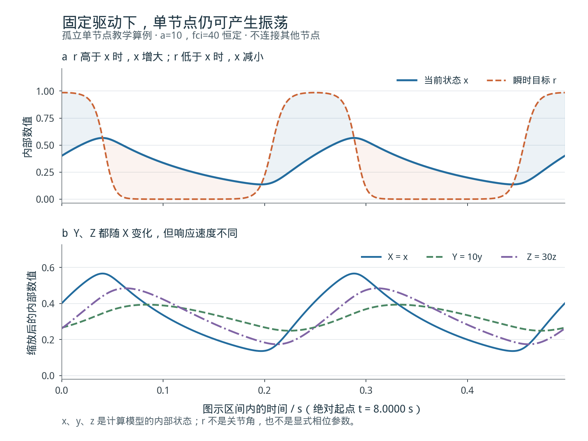
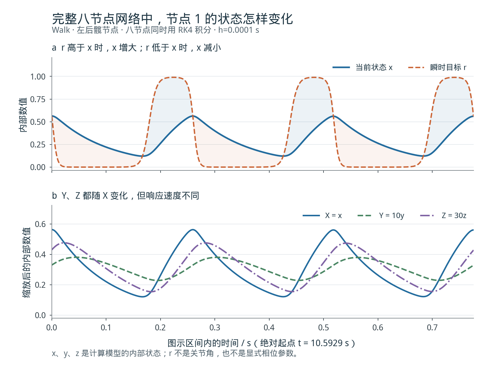
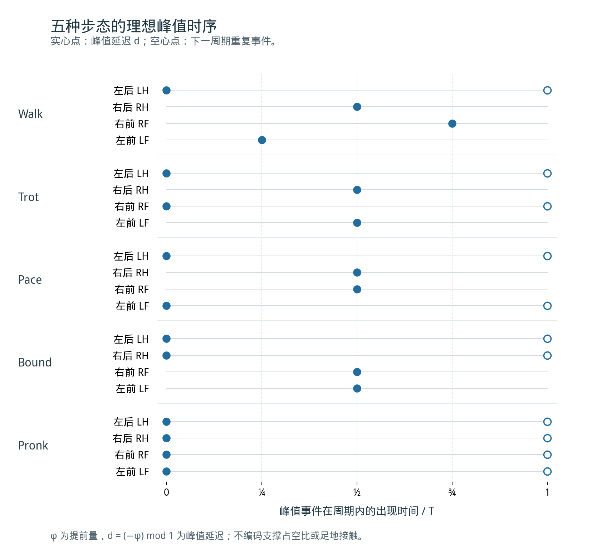
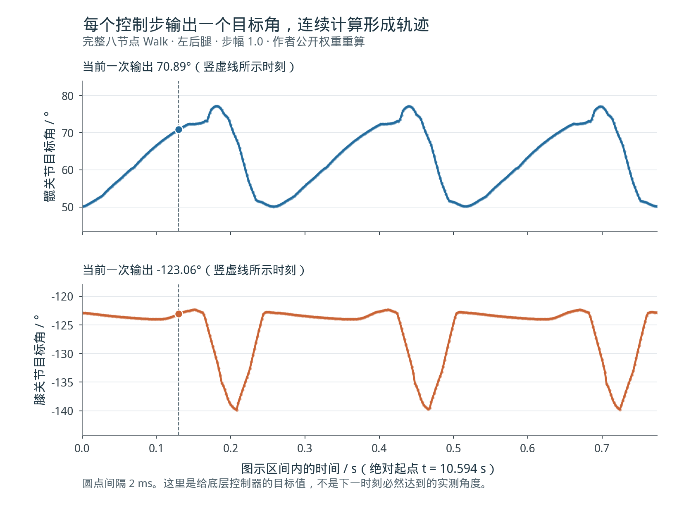
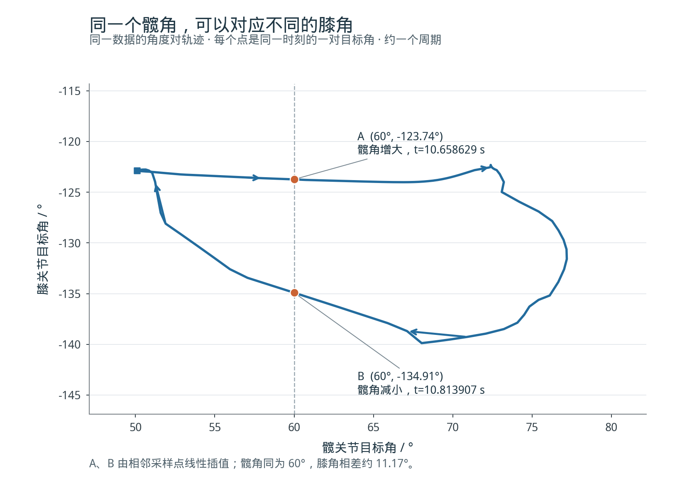
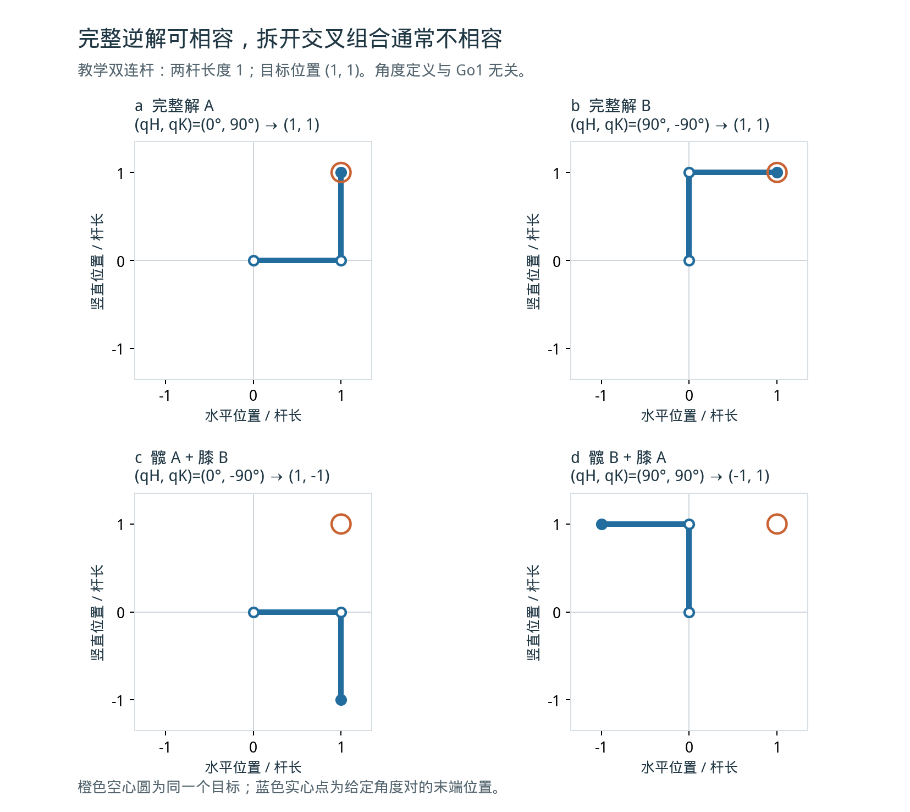

# 从振荡到步态：八神经元四足机器人控制论文精读

> 阅读对象：正在入门足式机器人、中央模式发生器（CPG）与强化学习运动控制的读者。  
> 整理日期：2026 年 10 月 18 日。  
> 本文将论文事实、公开代码能够核实的实现，以及用于解释机制的教学推导分开说明；数值重算产生的是控制器目标信号，不是真机测量。

## 文献信息

**题目：** *An eight-neuron network for quadruped locomotion with hip-knee joint control*  
**作者：** Yide Liu, Xiyan Liu, Dongqi Wang, Wei Yang, Shaoxing Qu  
**期刊：** *The International Journal of Robotics Research*  
**时间：** 2025 年 8 月 26 日在线发表；正式编入 2026 年第 45 卷第 4 期，602–627 页。下文的方法核对以 26 页 online-first 全文为准，因此使用原文节、表和附录编号定位。  
**论文：** [DOI 10.1177/02783649251364286](https://doi.org/10.1177/02783649251364286)  
**预印本：** [arXiv:2406.13419](https://arxiv.org/abs/2406.13419)  
**代码：** [作者仓库](https://github.com/ImDipsy/cpg_go1_simulation)，本精读核查版本为 [cef012f12fed7316e307034d48f9c13df909de15](https://github.com/ImDipsy/cpg_go1_simulation/tree/cef012f12fed7316e307034d48f9c13df909de15)。

这篇论文提出一套显式产生内部节律的动力系统，再用监督训练的神经网络把节律转换成关节目标角。理解它，需要贯通三个层面：内部状态怎样振荡，多个节点怎样形成相对时序，以及这些时序怎样变成机器人能够执行的动作。

论文中“八神经元网络”与“执行神经网络”是两个不同模块。前者是持续积分的微分方程系统；后者采用多层感知机（MLP），将当前输入映射为当前角度。只有先分清这两者，后面的训练、相位和切换问题才容易理解。

本文的评价立场是：该工作的主要价值在于节律网络结构、关节间相对时序和切换机制的研究。它没有通过与强化学习的同条件对照，证明更高速度、更强抗扰性或更低总设计成本。五种步态的实现是其验证内容，但“能实现五种步态”本身不是足以压倒其他控制路线的优势。

## 阅读路线

1. [先分清控制链中的几种量](#s1)
2. [把整项工作分为离线准备和运行过程](#s2)
3. [单个节点的 x、y、z 到底是什么](#s3)
4. [振荡怎样产生：谁在追赶谁](#s4)
5. [初值和数值积分：第一个计算步如何发生](#s5)
6. [八个节点怎样连接、相位差怎样设计](#s6)
7. [执行网络怎样训练、一次输出什么](#s7)
8. [用真实权重走完一条腿的数据流](#s8)
9. [髋、膝分别计算，怎样保持配对](#s9)
10. [为什么直接换参数可能失败](#s10)
11. [论文的实验实际证明了什么](#s11)
12. [与纯强化学习和节律奖励的区别](#s12)
13. [客观评价：贡献、代价与证据边界](#s13)
14. [复现注意、学习检查与参考文献](#s14)

## 1. 先分清控制链中的几种量

“机器人在走”和“控制器内部有周期波形”是不同层面的事实。一条完整控制链至少包含下面这些量。

| 量 | 回答的问题 | 在本文中的例子 |
|---|---|---|
| 高层命令 | 希望采用什么行为？ | Walk、Trot、步幅比例 |
| CPG 状态 | 内部节律系统现在处于什么状态？ | 每个节点的 $x_i,y_i,z_i$ |
| 相位或相对时序 | 当前走到周期哪里，两个节点谁先谁后？ | 四分之一周期、半周期 |
| 关节目标角 | 当前希望关节转到多少？ | $q_H^*(t),q_K^*(t)$ |
| 实际关节角与脚端运动 | 机器人受力后实际怎样运动？ | 电机跟踪、接触、滑动、身体位姿 |

CPG 的 $x_i$ 不是关节角；本文讲解中定义的 $r_i$ 也不是关节角。目标角 $q_i^*$ 与实际角 $q_i$ 还可能因电机能力、跟踪误差和地面接触而不同。

### 1.1 周期、频率、相位和占空比

若某个稳定重复运动每隔 $T$ 秒再出现一次，$T$ 是周期，频率为 $1/T$。相位描述沿该循环的位置；既可以用 $0$ 到 $1$ 的周期比例，也可以用 $0$ 到 $2\pi$ 的角度表示。

“相差四分之一周期”等价于相位差 $90^\circ$，但这 **不是关节转过了 $90^\circ$**。一个髋关节完全可以只在几十度范围内摆动，同时其节律相位走过完整的 $360^\circ$。

占空比描述某一阶段占整个周期的比例，例如支撑时间占比。相位差主要描述多个节律的相对位置，占空比主要描述单个周期内部的时间分配。两者也不能混用。

### 1.2 节律、关节轨迹和步态

只知道“两条腿相差半周期”，还不知道脚抬多高、关节摆多大，以及身体是否能稳定前进。相对时序、单腿运动形状和接触动力学共同影响步态。

例如 Trot 的典型时间组织是两组对角腿交替运动，但要让机器人真正跑起来，还需要适当的足端轨迹、支撑和推力。因此，本文的 CPG 负责内部时序组织，执行网络负责角度映射，机器人仿真检验两者组合后的机械结果。[1，§§3–5](#ref-paper)

## 2. 把整项工作分为离线准备和运行过程

阅读论文时，最容易混淆的是“参数搜索”“执行网络训练”与“运行时计算”。它们发生在不同阶段。

### 2.1 离线准备

| 步骤 | 做什么 | 得到什么 |
|---|---|---|
| 1 | 规定五种目标节律及节点到关节的对应 | 期望同步分组、相对相位、固定关节编号 |
| 2 | 设计网络连接，选择 Stein 模型 | 八节点耦合动力系统 |
| 3 | 搜索并检验动力学参数 | 各步态的参数组合和可用周期运动 |
| 4 | 研究二十种有向切换 | 各转换所需的换参、等待和刺激策略 |
| 5 | 为步态和步幅设计足端轨迹，计算逆运动学（IK） | 相容的髋、膝参考角度 |
| 6 | 将神经特征与参考角配对，监督训练执行网络 | 一组固定的执行网络权重 |

“搜索 CPG 参数”和“训练执行网络权重”并不是同一件事。前者寻找可以产生所需节律的动力学条件；后者学习神经特征到关节角的映射。

论文披露了这条总体路线，但没有完整公开第 3 步的搜索程序，也没有完整公开第 5–6 步中足端参考生成、逆解选支以及神经特征与角度标签对齐的生成代码。公开训练脚本从已经配好角度标签的数据行开始。[1，表3、§5.1；2](#ref-code)

### 2.2 运行时

在每个控制时刻，控制器选择当前步态参数，更新 CPG，取八个节点的当前信号，将它们送入执行网络，得到八个髋膝目标角，再交给底层关节控制。下一时刻重复上述过程。

原文将提供步态调节信号的上层模块称为 MLR，即中脑运动区（mesencephalic locomotor region）模块。在这里，这是仿生功能命名：它为节律网络提供驱动和参数调节，不表示程序模拟了一个完整的生物脑区。[1，§5.1、图6](#ref-paper)

其核心计算可以概括为：

$$
\mathbf s_{n+1}=\operatorname{Integrate}\!\left(F,\mathbf s_n,\mathbf p_n,\Delta t\right),
$$

$$
q_i^*(t_n)=D_\psi\!\left(c_i,g_n,\ell_i,x_i(t_n),\widehat{\dot x}_i(t_n)/50\right).
$$

其中：

- $\mathbf s$ 是全部八节点的 $24$ 维内部状态。
- $\mathbf p$ 是 CPG 参数与切换刺激。
- $c_i$ 是关节身份，$g$ 是步态编码，$\ell$ 是步幅指令。
- $D_\psi$ 是训练后的执行网络。
- $\widehat{\dot x}$ 表示代码中数值近似的导数。

上式把两层计算分开了：先更新有记忆的内部状态，再用当前特征计算角度。执行 MLP 自身没有循环记忆；周期记忆主要存在于 CPG 状态中。

公开演示包含两种实现路径：普通步态/切换示例先计算或读取 CPG 的 CSV，再逐行驱动机器人；传感反射控制路径也提供保留完整状态、在线积分的实现。程序中 $500$ Hz 是控制和物理步进设置，不是真机硬实时性能的测量结果。[2](#ref-code)

## 3. 单个节点的 x、y、z 到底是什么

### 3.1 八节点，实际上有二十四个状态量

每个节点都有三个状态：

$$
\mathbf s_i=(x_i,y_i,z_i).
$$

八个节点共同组成 $24$ 维动力系统。一个节点与一个髋或膝屈伸关节对应，但节点内部的三个状态并不分别对应三个物理关节。

| 状态 | 原模型中的解释 | 在机器人控制中的实际使用 |
|---|---|---|
| $x_i$ | 神经元膜电位相关状态 | 虚拟节律信号，之后供执行网络解码 |
| $y_i$ | 描述膜电位变化的化学动力学项 | 对 $x_i$ 历史具有较慢响应的内部状态 |
| $z_i$ | 描述膜电位变化的化学动力学项 | 对 $x_i$ 历史具有较快响应的内部状态 |

原论文采用生物神经元模型的解释，但在程序中并没有测量真实神经细胞，也没有把这些数直接当成髋角、膝角、脚端坐标或电机力矩。[1，§3.2](#ref-paper)

### 3.2 方程及其计算顺序

把原论文式（4）用其选定常数展开，可写为：

$$
\dot x_i=a_i\left[\sigma(f_{ci}-2000y_i+2000z_i)-x_i\right],
$$

$$
\dot y_i=x_i-10y_i,\qquad \dot z_i=x_i-30z_i,
$$

$$
\sigma(u)=\frac{1}{1+e^{-u}}.
$$

为了让第一条方程更容易读，本文把 sigmoid 输出单独记作：

$$
r_i=\sigma(f_{ci}-2000y_i+2000z_i).
$$

于是：

$$
\dot x_i=a_i(r_i-x_i).
$$

**$r_i$ 是解释时引入的中间量，不是论文额外提供的相位旋钮。** 它由当前状态和耦合输入算出，也没有独立的一条积分方程。

计算一个时刻的导数时，先用当前邻居状态和参数求 $f_{ci}$，再由当前 $y_i,z_i$ 求 $r_i$，最后得到三个状态的变化速度。经过数值积分，才得到下一时刻的状态。

### 3.3 将 y、z 变换为更直观的量

由于 $y,z$ 与 $x$ 的数值尺度不同，直接画在一起容易误解。定义：

$$
X_i=x_i,\qquad Y_i=10y_i,\qquad Z_i=30z_i.
$$

则：

$$
\dot Y_i=10(X_i-Y_i),\qquad
\dot Z_i=30(X_i-Z_i).
$$

这就得到一个明确关系：

- $Y_i$ 朝着当前 $X_i$ 变化。
- $Z_i$ 也朝着当前 $X_i$ 变化。
- $Z_i$ 的响应更快，特征时间约为 $1/30$ 秒；$Y_i$ 约为 $1/10$ 秒。

例如当前 $X$ 突然增大，$Z$ 会比 $Y$ 更快靠近它。这些历史响应又进入 $r$ 的计算，使 $X$ 下一步的变化趋势发生改变。

在同一变换下：

$$
r_i=\sigma\!\left(f_{ci}-200Y_i+\frac{2000}{30}Z_i\right).
$$

因此，$Y$ 增大会减小 sigmoid 的输入，$Z$ 增大会增加它。这里的正负作用都是具体的算术关系，不需要把它们想象成关节彼此“压制”。

## 4. 振荡怎样产生：谁在追赶谁

### 4.1 只有追赶固定目标，不会持续振荡

若人为把 $r$ 固定为常数 $r_0$：

$$
\dot x=a(r_0-x),
$$

其解为：

$$
x(t)=r_0+[x(0)-r_0]e^{-at}.
$$

它会逐渐接近 $r_0$，而不是永远上下摆动。

因此，持续振荡的关键不在“存在追赶”这几个字，而在于 **目标 $r$ 本身也随内部状态不断变化**。

### 4.2 快慢反馈让移动目标不断改变

在能够产生周期运动的参数区域，常见的一轮过程可以这样理解：

1. 当前 $r>x$，于是 $x$ 增大。
2. $x$ 增大后，较快的 $Z$ 和较慢的 $Y$ 都开始跟随。
3. 两种反馈以不同速度积累，对 $r$ 的正负作用不断变化。
4. 某个阶段 $r$ 变得小于 $x$，于是 $x$ 转为减小。
5. $x$ 减小后，$Z$ 较快下降，$Y$ 较慢释放；反馈关系继续改变。
6. 如果系统处于合适的周期运动区域，上述过程再次发生。

这是一种帮助理解的反馈过程描述，不表示所有参数或初值都会产生稳定周期。对给定参数是否存在稳定限环，仍需要动力学分析或数值检验。

*图 1：恒定驱动下的孤立 Stein 单节点教学算例。它用于解释内部快慢状态怎样参与振荡，不等同于完整八节点 Walk 仿真。*

[打开单节点交互演示](interactive/single-neuron-rhythm.html)

完整八节点仿真还包含邻居的作用：

*图 2：完整八节点 Walk 数值轨迹中，左后髋节点的内部信号与移动目标。$Y=10y,Z=30z$ 仅作尺度变换；它们仍然是内部状态。*

[打开 x 与 r 的追赶演示](interactive/chasing-oscillation.html)

### 4.3 r 能影响时序，但 r 的数值不是相位

方向由 $r-x$ 决定。假设 $a=10$：

| 教学状态 | $x$ | $r$ | $\dot x$ |
|---|---:|---:|---:|
| A | 0.2 | 0.5 | $+3$ |
| B | 0.8 | 0.5 | $-3$ |

相同的 $r$，甚至可能对应相反的 $x$ 变化方向。一个连续周期波形，也常在上升和下降过程中经过同一数值。因此：

- $r=0.8$ 不表示完成周期的 $80\%$。
- $r_1>r_2$ 不表示节点 1 一定领先节点 2。
- 同一时刻 $r_1=r_2$ 不足以说明同步。

如果比较的是完整的 $r_i(t)$ 波形，就可以研究其中同类事件的相对发生时间。这个意义上，$r$ 的波形携带时序信息；但不能把某一帧中的高度差直接当成相位差。

还有一个连接执行网络的有用关系：

$$
r_i=x_i+\frac{\dot x_i}{a_i}.
$$

当 $a_i$ 固定时，理论上的 $(x_i,\dot x_i)$ 与 $(x_i,r_i)$ 可以互相换算。执行网络虽然没有单独输入 $r_i$，却通过导数接收了 $r_i-x_i$ 所体现的变化趋势。

## 5. 初值和数值积分：第一个计算步如何发生

### 5.1 论文使用什么初值

下表按论文表 6 和公开实现整理，节点编号从 1 开始。

| 节点 | 所属关节 | $x_i(0)$ | $y_i(0)$ | $z_i(0)$ |
|---|---|---:|---:|---:|
| 1 | 左后髋 | 1 | 0.040 | 0.016 |
| 2 | 右后髋 | 1 | 0.045 | 0.018 |
| 3 | 右前髋 | 0.8 | 0.050 | 0.020 |
| 4 | 左前髋 | 1 | 0.025 | 0.014 |
| 5 | 左后膝 | 1 | 0.045 | 0.018 |
| 6 | 右后膝 | 0.8 | 0.050 | 0.020 |
| 7 | 右前膝 | 1 | 0.025 | 0.014 |
| 8 | 左前膝 | 1 | 0.040 | 0.016 |

这些初值确定动力系统从哪里出发。它们不是由机器人实测初始关节角经某个已公开公式换算出来的；具体选择过程在公开材料中没有详细说明。[1，表6；2](#ref-code)

初值与参数分工不同：参数确定演化规则和可能的长期模式；初值确定从哪个状态出发，并影响最终进入哪个模式。将所有节点设为相同数值也不必然得到所需步态；在保持某些对称性的系统中，完全相同的初态可能一直停留在对应的同步状态集合中。

### 5.2 从左后髋节点的初态算一次

在 Walk 下：

$$
f_{c1}=40(1-0.15x_4-0.1x_5).
$$

初始时 $x_4=x_5=1$，所以：

$$
f_{c1}(0)=30.
$$

节点 1 的 $y_1=0.040,z_1=0.016$，因而：

$$
r_1(0)=\sigma(30-2000\times0.040+2000\times0.016)
=\sigma(-18)\approx1.523\times10^{-8}.
$$

于是：

$$
\dot x_1(0)\approx-9.99999985,\qquad
\dot y_1(0)=0.6,\qquad
\dot z_1(0)=0.52.
$$

这三个数分别说明：当前 $x$ 快速减小，而 $y,z$ 仍在增大。只看某个状态此刻的高度，无法判断完整的循环阶段。

为看清“导数怎样变成下一个状态”，先用教学用的前向 Euler 步，取 $h=10^{-4}$ 秒：

$$
(x_1,y_1,z_1)_{\mathrm{next}}
\approx
(0.999000000015,\;0.040060,\;0.016052).
$$

**这只是展示更新含义。论文实际使用四阶 Runge–Kutta（RK4），不是上面的一次 Euler 近似。**

### 5.3 RK4 为什么要更新全部节点

把完整状态写成 $\mathbf s$，方程写成 $\dot{\mathbf s}=F(t,\mathbf s)$。一个 RK4 步为：

$$
\begin{aligned}
\mathbf k_1&=F(t,\mathbf s),\\
\mathbf k_2&=F(t+h/2,\mathbf s+h\mathbf k_1/2),\\
\mathbf k_3&=F(t+h/2,\mathbf s+h\mathbf k_2/2),\\
\mathbf k_4&=F(t+h,\mathbf s+h\mathbf k_3),\\
\mathbf s_{\mathrm{next}}&=\mathbf s+\frac h6(\mathbf k_1+2\mathbf k_2+2\mathbf k_3+\mathbf k_4).
\end{aligned}
$$

每个中间阶段都要根据该阶段的全体状态重新计算耦合。不能先把髋节点孤立更新一整段，再把膝节点孤立更新一整段，否则会改变它们相互作用的时间关系。

公开实时实现以 $10^{-4}$ 秒为积分小步，在一个 $2$ ms 控制间隔内计算 20 个小步。导数输出采用数值近似；控制采样与积分小步是两个不同的时间尺度。[2](#ref-code)

## 6. 八个节点怎样连接、相位差怎样设计

### 6.1 固定的节点到关节映射

上层节点 1–4 分别对应左后、右后、右前、左前的髋屈伸，下层节点 5–8 对应同样顺序的膝屈伸。同腿节点配对为 $(1,5),(2,6),(3,7),(4,8)$。

上层单向环为：

$$
1\rightarrow3\rightarrow2\rightarrow4\rightarrow1.
$$

下层方向相反：

$$
5\rightarrow8\rightarrow6\rightarrow7\rightarrow5.
$$

每一对髋、膝还双向连接。$\alpha$ 控制上层环，$\beta$ 控制下层环，$\gamma$ 控制髋到膝，$\delta$ 控制膝到髋。常规五步态与切换中采用：

$$
\alpha=\beta=-0.15,\qquad \gamma=-0.6,\qquad\delta=-0.1.
$$

这里的系数是作用强度，不是目标角、时间延迟或者相位角。[1，图3、表2–3](#ref-paper)

### 6.2 耦合如何进入节点

把接收节点 $i$ 的耦合写清楚：

$$
f_{ci}^{h}=f^h\left[
1+k_1^h\sin(k_2^h t)
+\alpha\sum_{j=1}^{4}\lambda_{ji}x_j
+\delta\sum_{j=5}^{8}\lambda_{ji}x_j
\right],
$$

$$
f_{ci}^{k}=f^k\left[
1+k_1^k\sin(k_2^k t)
+\beta\sum_{j=5}^{8}\lambda_{ji}x_j
+\gamma\sum_{j=1}^{4}\lambda_{ji}x_j
\right].
$$

$\lambda_{ji}$ 表示是否存在从 $j$ 到 $i$ 的连接。对于左后腿的 Walk 算例：

$$
f_{c1}=40(1-0.15x_4-0.1x_5),\qquad
f_{c5}=40(1-0.15x_7-0.6x_1).
$$

髋状态在膝方程中的直接项为 $-24x_1$。暂时固定其他状态，若 $x_1$ 从 $0.2$ 增至 $0.8$，膝 sigmoid 输入减少 $14.4$，从而改变膝此刻的变化速度。

这种数值作用每轮都持续发生，所以会改变节点上升、下降和达到峰值的时间。但是不能由这一个瞬间推断最终“延迟了多少”；完整相位关系由全网络的演化产生。

### 6.3 哪些相位模式是目标

采用原文约定：

$$
x_i(t)=x_1(t+\varphi_iT).
$$

下表的正数表示向参考波形的较后时间取值，即通常所说的相位提前；不要把它直接读成“峰值晚了这么久”。

| 节律 | 左后 1 | 右后 2 | 右前 3 | 左前 4 | 同步关系 |
|---|---:|---:|---:|---:|---|
| Walk | 0 | $1/2$ | $1/4$ | $3/4$ | 四节点依次错开 |
| Trot | 0 | $1/2$ | 0 | $1/2$ | 两组对角腿 |
| Pace | 0 | $1/2$ | $1/2$ | 0 | 左右两组 |
| Bound | 0 | 0 | $1/2$ | $1/2$ | 前后两组 |
| Pronk | 0 | 0 | 0 | 0 | 全部同步 |

该表来自论文表 1。它是节点波形的模式，不是对实际足地接触时刻的直接测量。

*图 3：用理想周期波形展示相对时序。横轴上的峰值延迟为 $d_i=(-\varphi_i)\bmod1$；它与表中的相位提前量方向相反。曲线形状只是教学示意，不是 Stein 网络原始输出，也不用于推断真实支撑占空比。*

[打开五种节律的交互演示](interactive/gait-phase-rhythms.html)

### 6.4 对称性负责筛选结构，具体相位还要靠参数和状态

论文先从具有 $D_4$ 对称性的四节点结构出发，将每个节点扩成髋膝一对，用全局关系讨论腿间节律，用局部关系讨论同腿髋膝时序。

H/K 定理在这里的作用，是讨论具有相应对称性的系统类中，哪些时空对称周期模式允许存在。定理并不意味着给定本论文所有具体参数后，从任意初值出发都保证收敛到目标步态。

实际采用 $\gamma\ne\delta$ 等不等价设置后，原本的部分对称关系被打破。论文也承认这一点，后续主要依靠数值轨迹与扰动试验验证所需模式。因此，不能把结构层面的存在性论证直接写成完整机器人控制器的稳定性证明。[1，§§2–3、附录E–G](#ref-paper)

### 6.5 参数究竟怎样得到

论文表 3 将耦合参数的来源列为“对称性考虑与参数搜索”，将 $a,f,k_1,k_2$ 的来源列为既有模型工作与参数搜索。它没有提供一个“输入目标相位，解析反算全部参数”的通用算法。

一种具体的设计验证流程是：规定目标同步关系，选择候选参数，积分至稳定区间，测量各节点同类周期事件的时间差，再检查它们是否保持目标关系。这是参数搜索怎样落实的教学说明，不是作者已公开的完整搜索脚本。

原文表 7 给出的组合如下：

| 参数 | Walk | Trot | Pace | Bound | Pronk |
|---|---:|---:|---:|---:|---:|
| $a^h$ | 10 | 11 | 11 | 16 | 22 |
| $f^h$ | 40 | 41 | 41 | 50 | 65 |
| $k_1^h$ | 0 | 0.085 | 0.04 | 0.1 | 0.3 |
| $k_2^h$ | 0 | 56 | 54 | 59 | 60 |
| $a^k$ | 10 | 11 | 11 | 14 | 22 |
| $f^k$ | 40 | 41 | 41 | 45 | 65 |
| $k_1^k$ | 0 | 0 | 0.01 | 0 | 0.2 |
| $k_2^k$ | 0 | 0 | 54 | 0 | 60 |
| 周期 / s | 0.259 | 0.224 | 0.233 | 0.213 | 0.209 |

$k_2$ 是 $\sin(k_2t)$ 中的角频率系数，不是 Hz，也不直接等于最终步频。Walk 的 $k_1=0$，系统仍然可以自行振荡，说明周期不是单纯由外部正弦信号直接播放出来的。

### 6.6 同腿髋膝相位可以怎样调

附录 G 固定其他 Walk 参数、改变 $\gamma$，记录到的稳定相位偏移范围约为 $0.25$–$0.62$ 个周期；部分参数值不能产生稳定限环。基线 $\gamma=-0.6,\delta=-0.1$ 的相位偏移约为 $1/4$ 周期；交换两者后，按原文约定变为 $3/4$ 周期，即相对先后关系反转。[1，附录G](#ref-paper)

这些是数值扫参结果，不是全局解析定律。相位既不由某个瞬时 $r_i-r_j$ 唯一确定，也不能简单说只由一个耦合系数决定。节点参数、耦合、当前状态和所处长期模式共同参与其中。

## 7. 执行网络怎样训练、一次输出什么

### 7.1 先确定参考运动，再学习映射

CPG 信号通常不直接等于可用的关节角曲线。论文先为每种步态和步幅设计足端轨迹，再由逆运动学计算髋、膝参考角，最后用这些角度监督训练执行网络。每种步态采用五条不同步幅的参考轨迹，步幅指令范围为 $[0.8,1.2]$。[1，§5.1](#ref-paper)

这一步是监督学习。正确答案来自预设计轨迹和逆运动学，并非通过机器人试错、累计回报最大化得到。

### 7.2 十一维输入具体是什么

| 部分 | 维数 | 内容 |
|---|---:|---|
| 关节身份 | 3 | 髋/膝、前/后、左/右三个二进制属性 |
| 步态身份 | 5 | Walk、Trot、Pace、Bound、Pronk 的 one-hot 编码 |
| 步幅指令 | 1 | 连续值 $\ell$ |
| 本节点信号 | 1 | 当前 $x_i$ |
| 本节点导数 | 1 | 数值导数 $\widehat{\dot x}_i/50$ |

这里是“十一维特征”，并非十一个量都只能取 0 或 1。关节的三位编码也不是 one-hot：它描述三个二元属性。

左后髋编码为 $[0,1,0]$，左后膝为 $[1,1,0]$；Walk 的五位编码为 $[1,0,0,0,0]$。因此，对于左后髋：

$$
\mathbf u_H=
[0,1,0,\;1,0,0,0,0,\;\ell,\;x_1,\;\widehat{\dot x}_1/50].
$$

单行输入不直接包含其他节点状态、另一个关节刚输出的角度、脚端位置或完整的一周期曲线。邻居的作用已经通过 CPG 动力学改变了本节点状态。[2，执行网络输入构造](#ref-code)

### 7.3 十一维输入怎样变成一个角度

执行网络为：

$$
11\rightarrow24\rightarrow12\rightarrow1.
$$

两个隐藏层采用 ReLU，输出层为线性层：

$$
\mathbf h_1=\operatorname{ReLU}(W_1\mathbf u+\mathbf b_1),
$$

$$
\mathbf h_2=\operatorname{ReLU}(W_2\mathbf h_1+\mathbf b_2),
$$

$$
q^*=W_3\mathbf h_2+b_3.
$$

一个单元先对输入作加权求和、加偏置，再把负结果截为零。经过两层这种处理，最后将隐藏特征加权组合为一个数。训练通过调整这些权重和偏置，使输出接近角度标签。

参数总数为：

$$
(11\times24+24)+(24\times12+12)+(12\times1+1)=601.
$$

这里有一个必须保留的披露边界：论文给出了 24 和 12 的结构，但没有给出使它们成为理论最优、最少或唯一选择的推导，也没有披露相关结构搜索或消融。因此，应将它们理解为所采用的网络配置，而不是从八节点 CPG 必然推导出的层宽。[1，图6；2](#ref-code)

### 7.4 为什么需要导数

同一个 $x$ 值可能在上升阶段和下降阶段各出现一次，而这两个阶段可能要求不同关节角。$\dot x$ 的符号和大小有助于区分它们。

但 $(x,\dot x)$ 并不是对任意全网络状态都唯一确定阶段的定理。固定关节、步态和步幅后，如果两种状态具有相同输入，却要求不同输出，那么任何确定性的前馈网络都无法同时满足。增加层数不能弥补输入信息本身的缺失。

### 7.5 公开训练设置说明了什么

公开训练脚本使用角度均方误差、Adam、初始学习率 $0.01$、batch size 32，训练/验证划分为 80/20，最多训练 100 轮，并允许提前停止。所检查权重文件记录的 epoch 为零基编号 87，即第 88 轮，最佳验证损失约为 $9.85\times10^{-5}$。[2](#ref-code)

这些数说明该检查点的监督拟合配置。它们不等于足端位置误差、身体稳定裕度或者真机可靠性。原始训练样本总数、完整生成脚本及全部训练曲线没有在所查材料中完整提供。

### 7.6 单次输出和一周期输出的区别

单行输入只得到一个当前目标角，单位为 rad。将八个关节输入排成 $8\times11$ 的批次，就得到八个同一控制时刻的目标角。

一个周期的角度曲线，是在连续很多控制时刻重复调用网络，按时间顺序连接这些输出形成的。它既不是一次输出整段曲线，也不保证机器人在下一物理步必然精确到达目标角。

## 8. 用真实权重走完一条腿的数据流

本节数值使用作者公开的执行网络权重，对完整八节点 Walk 数值信号进行重算。步幅在本例显式设置为 1；这与普通推理脚本中硬编码的 0.8 要区别对待。表中输入经过显示舍入，最后若干位可能随浮点计算顺序略有变化。

### 8.1 同一个时刻的两组输入

在 CPG 时间 $t=10.594$ s，左后腿对应的局部特征与输出约为：

| 项目 | 左后髋（节点 1） | 左后膝（节点 5） |
|---|---:|---:|
| $x_i$ | 0.56268122 | 0.28301197 |
| $\widehat{\dot x}_i$ | -0.59807069 | -2.83153506 |
| $\widehat{\dot x}_i/50$ | -0.01196141 | -0.05663070 |
| 网络目标角 / rad | 0.8745343 | -2.1446793 |
| 网络目标角 / degree | 50.1071 | -122.8811 |

把左后髋的十一维输入写全：

$$
\mathbf u_H=[
0,1,0,\;
1,0,0,0,0,\;
1,\;
0.56268122,\;
-0.01196141
].
$$

这些数字不是一段时间序列；它们是“关节身份 + 当前任务条件 + 当前局部状态”。

### 8.2 把实际权重的各层计算接起来

将这组左后髋输入代入第一层加权和与 ReLU，24 个隐藏单元中只有第 5、14、17、24 个为正，约为：

$$
h_{1,5}=0.29519284,\quad h_{1,14}=1.15410089,\quad
h_{1,17}=1.17317879,\quad h_{1,24}=1.19057894.
$$

其余单元在 ReLU 之后为零。将这个 24 维向量继续送入第二层，12 个单元中仅第 5 和第 11 个为正，约为：

$$
h_{2,5}=0.79172045,\qquad
h_{2,11}=1.76742423.
$$

对应的输出权重与偏置为：

$$
W_{3,5}=-0.12765189,\quad
W_{3,11}=0.24148856,\quad
b_3=0.54878616.
$$

所以：

$$
q_H^*\approx
-0.12765189\times0.79172045
+0.24148856\times1.76742423
+0.54878616
=0.8745343\ \mathrm{rad}.
$$

这就是一次前向计算如何产生一个角度数值。膝使用同一组网络权重，但身份编码和局部特征不同，激活的隐藏单元也不同，所以得到另一个输出。

### 8.3 后续数据怎样流动

在下一个控制时刻，取更新后的节点 1 和节点 5 特征，再计算下一对角度。对另外三条腿也做同样的事。

代码把八个输出填入十二关节控制数组，另四个髋外展目标为零；先设置所有关节目标，再推进物理仿真。角度计算可以批量完成，计算先后不等于机器人先执行髋、再执行膝。[2](#ref-code)

*图 4：完整 CPG 信号经公开权重得到的左后腿目标角。每个采样时刻只输出当前角度；连接多个时刻才形成曲线。*

[打开逐时刻输入输出演示](interactive/joint-target-step.html)

这段重算验证的是“CPG 特征到目标角”的数值链，没有运行完整身体接触仿真，因此不能据此声称已独立复现论文全部运动性能。

## 9. 髋、膝分别计算，怎样保持配对

### 9.1 正确的对象是一条角度对轨迹

固定步态下，可以把参考运动写成：

$$
\phi\longmapsto\bigl(Q_H(\phi),Q_K(\phi)\bigr).
$$

这里 $\phi$ 是为解释引入的共同周期进度，实际执行网络没有这个额外输入。

它不一般等价于 $q_K=F(q_H)$。同一个髋角可以在周期不同阶段配上不同膝角。下面把真实权重输出画在“髋角—膝角”平面中，每个点对应同一时刻的一对角度。

*图 5：左后腿约一个周期的目标角配对轨迹。竖线与轨迹的两个交点具有相同髋角，却具有不同膝角；交点按采样间线性插值定位。*

[打开髋膝角配对演示](interactive/hip-knee-pairing.html)

### 9.2 第一种错配：把两个逆解分支拆开组合

同一个末端位置可能有多个完整逆运动学解。以教学双连杆为例，两杆长度均为 1，髋角相对水平，膝角为第二杆相对第一杆的转角：

$$
p_x=\cos q_H+\cos(q_H+q_K),\qquad
p_y=\sin q_H+\sin(q_H+q_K).
$$

目标为 $(1,1)$ 时，$(0^\circ,90^\circ)$ 和 $(90^\circ,-90^\circ)$ 都是完整解。若取前者的髋角和后者的膝角，脚端变成 $(1,-1)$；另一种交叉组合会到达 $(-1,1)$。

*图 6：完整逆解可以到达同一目标，拆开交叉组合通常不再满足该目标。这是教学几何，不代表 Go1 的关节定义或可用范围。*

[打开逆解交叉组合演示](interactive/ik-branch-pairing.html)

正确的数据准备应先结合关节限位、屈膝方向和沿轨迹的连续性，选择相容的完整角度对，再将髋、膝分别作为对应训练行的标签。在线 MLP 并不以脚端位置为输入，也不在每一步重新挑选 IK 分支；它计算的是已经训练出的确定函数。

### 9.3 第二种错配：两个角度来自不同运动阶段

假设所选的教学相位约定满足：

$$
\theta_K=\theta_H+\Delta_0\pmod1.
$$

两路神经信号的局部相位不同，但训练可以把它们关联到同一个全腿参考阶段。若 $\Delta_0=0.25$：

| 神经信号局部阶段 | 应对应的参考角 |
|---|---|
| 髋局部 20% | 参考阶段 20% 的髋角 |
| 膝局部 45% | 参考阶段 20% 的膝角 |

理想映射可以用下面的形式理解：

$$
q_H^*\approx Q_H(\theta_H),\qquad
q_K^*\approx Q_K(\theta_K-\Delta_0).
$$

代入锁相关系，两者就是同一参考阶段的一对角。真实网络没有显式做相位减法；它通过各自的 $(x,\dot x)$ 特征学习这种对应。

### 9.4 训练行怎样配出这种关系

一种具体可行的制作方式是：

1. 让 CPG 进入目标周期运动，选取一个共同的周期参考。
2. 对每个共同进度 $\phi_n$ 确定足端参考位置。
3. 用同一次 IK 计算一整对 $Q_H(\phi_n),Q_K(\phi_n)$。
4. 取同一对应时刻的髋节点与膝节点特征。
5. 分别生成“髋特征—髋标签”和“膝特征—膝标签”两行样本。

这是一种说明配对如何实现的方案。公开代码从已经配好标签的 CSV 开始，没有披露作者具体采用哪个参考事件、如何重采样、如何选择 IK 分支。不能把上述教学方案冒充其未公开的原始生成算法。

训练可以随机打乱这些行。配对信息存在于“某种特征应对应哪个角度”的关系中，并不依赖前馈网络记住训练行出现的顺序。

### 9.5 独立输出为什么可能正确，又为什么没有普遍保证

两次角度计算虽然独立，产生输入的 CPG 状态却相互耦合。在标签对齐、局部特征足以辨认阶段且网络拟合准确的前提下，运行中维持与训练相容的波形和相对时序，才能让同一时刻的两路输出继续近似对应同一参考阶段。

但若膝额外偏移 $\varepsilon$，而执行网络不变：

$$
\theta_K=\theta_H+\Delta_0+\varepsilon,
$$

则输出可能变成：

$$
(q_H^*,q_K^*)\approx
\bigl(Q_H(\theta_H),Q_K(\theta_H+\varepsilon)\bigr).
$$

两个输出都可以连续、确定，却不再属于同一个参考阶段。配合成立依赖四个条件：

- 标签来自同一运动阶段和相容的完整逆解。
- 运行中的神经波形与相位关系和训练相容。
- 局部输入足以确定所需角度。
- 网络拟合误差处于可接受范围。

公开损失函数是逐角度的 MSE，推理后没有每步将角度对投影回某个足端几何约束。因此，“同一批次输出”保证取样时间同步，不自动保证几何配对正确。[2](#ref-code)

若需要每步明确建立角度对的几何相容性，一种直接架构是：共同周期进度决定当前足端目标，再以选定分支的 IK 一次求出整对角度。两输出神经网络也可使用共同条件，但仅增加输出维数本身仍不等于硬几何保证。

## 10. 为什么直接换参数可能失败

### 10.1 更换演化规则，不等于瞬间到达目标运动

在切换时刻 $t_s$，程序可以直接把 Walk 参数替换为 Trot 参数。但如果不重置状态，就有：

$$
\mathbf s(t_s^+)=\mathbf s(t_s^-).
$$

之后的导数由新的方程规则决定：

$$
\dot{\mathbf s}(t_s^+)=F_{\mathrm{new}}(t_s,\mathbf s(t_s)).
$$

新的周期运动可能存在于状态空间的另一个位置。当前状态能否从这里走到它、经过什么过程、是否进入另一种竞争模式，都需要研究。

把初值直接重置成目标轨道上的一组数虽然可能改变内部节律，但还会带来指令跳变；真实机器人身体的姿态、速度和接触状态也不会随内部变量一起重置。因此，切换不是单纯的配置文件替换问题。

### 10.2 论文观察到的几类困难

**原有同步分组难以打破。** 例如从所有腿同步的节律，转为两组交替的节律，需要某些节点之间产生差别，仅改变所有节点的公共参数未必足够。

**目标模式之间存在竞争。** Trot 和 Pace 的参数相近，当前状态或切换阶段可能使系统进入另一种同步分组，或者出现无效节律。

**过渡过程不稳定或过长。** 即使最终回到目标模式，中间的信号也可能紊乱、振幅变化或存在较长过渡；机器人身体未必能在这一段保持可用运动。

原文把某些模式概括为较强或较弱的吸引子层级，这是基于所研究切换现象的经验描述。不能把它解释成已经计算出的势阱深度、Lyapunov 能量或速度等级。Bound 的报告速度就不高于 Trot。[1，§4、表4](#ref-paper)

### 10.3 四种策略是两个操作的组合

论文实际使用两个基本手段：**选择执行时机**，以及**短时额外刺激选定节点**。于是形成四种组合：

| 策略 | 是否等待合适阶段 | 是否加短时刺激 | 主要操作 |
|---|---|---|---|
| Switch | 否 | 否 | 直接换成目标动力学参数 |
| Power Pair | 否 | 是 | 换参，同时增强两个选定髋节点的驱动 |
| Wait & Switch | 是 | 否 | 等待成功窗口，再换参 |
| Wait & Power Pair | 是 | 是 | 等待成功窗口，再换参加刺激 |

它们对应本文观察到的失败机制，并非穷尽一切控制方法的理论分类。其他网络、参数和机器人可能需要不同策略。

### 10.4 Power Pair 实际改变了什么

Power Pair 临时增强两个髋节点的驱动参数 $f^h$，经过指定时长后返回目标步态的正常值。它改变的是神经网络演化，不是直接给机器人某两个电机施加额外力矩。

刺激对象按目标分组选择。例如目标为 Bound 时，两条后腿需要同步，可以刺激髋节点 1、2；目标为 Trot 时可选择对角的 1、3；目标为 Pace 时可选择同侧的 1、4。相同刺激对象不能不加区分地套到所有转换。

原文对刺激的增益比、总时长以及上升/下降沿持续比例分别给出了参数。例：Pronk→Trot 使用节点 1、3，增益比 $2.6$，总时长 $0.07$ s，并结合等待窗口。[1，附录C](#ref-paper)

### 10.5 Wait 怎样知道“现在是合适阶段”

论文使用节点 1 的信号及导数分支构造：

$$
F(x_1)=
\begin{cases}
x_1,&\dot x_1\ge0,\\
2-x_1,&\dot x_1<0.
\end{cases}
$$

这样，同样的 $x_1$ 在上升和下降阶段会得到不同指标值。设计者通过切换试验，找出该指标落在哪些区间时成功。

例如 Pronk→Trot 所用窗口为 $F(x_1)\in[0.52,0.70]$，进入窗口后才执行相应刺激。这个 $F$ 是周期位置判别指标，不是均匀增长的归一化相位，不能直接写成“相位等于 $F/2$”。

等待期间系统继续运行原来的节律。等到有利阶段再改动力学，改变的是切换出发状态。原文展示过 Pronk→Trot 在命令时刻立即执行失败，而稍后进入合适窗口执行成功的例子。[1，附录C、图12](#ref-paper)

### 10.6 二十种转换怎样分配

下表按“行是源步态，列是目标步态”整理。

| 源 → 目标 | Walk | Trot | Pace | Bound | Pronk |
|---|---|---|---|---|---|
| Walk | — | Wait & Switch | Wait & Switch | Switch | Switch |
| Trot | Switch | — | Wait & Switch | Switch | Switch |
| Pace | Switch | Wait & Switch | — | Switch | Switch |
| Bound | Wait & Power Pair | Wait & Power Pair | Wait & Power Pair | — | Switch |
| Pronk | Power Pair | Wait & Power Pair | Wait & Power Pair | Power Pair | — |

对应数量分别为 Switch 9 种、Power Pair 2 种、Wait & Switch 4 种、Wait & Power Pair 5 种。全部等待窗口与刺激参数另见[切换参数附录](appendix/transition-parameters.md)。

### 10.7 CPG 状态连续，不足以保证角度目标连续

这是评价“平滑切换”时必须单独检查的一点。

不重置状态，通常能保持 $x,y,z$ 的连续性。但是：

- 换参可能使 $\dot x$ 突变，而执行网络输入包含导数。
- 步态 one-hot 编码在切换时可能发生离散变化。
- 执行网络没有自动保证两种步态编码下输出值相接。

因此不能仅凭 CPG 的 $x$ 连续，就证明关节目标角连续，更不能进一步证明关节速度、力矩或地面接触力平滑。

在固定步态与连续输入条件下，ReLU MLP 是连续映射；切换过程是否满足这些输入连续条件，需要另外核查。论文的身体仿真提供了特定转换下的经验结果，而不是这一点的通用数学保证。

## 11. 论文的实验实际证明了什么

### 11.1 平台与自由度

物理验证使用 PyBullet 3.2.6 中的 Unitree Go1 模型。每条腿的髋外展/内收自由度锁定，控制髋屈伸和膝屈伸，共八个主动角度。[1，§5](#ref-paper)

这不是本控制器的真机试验。使用商业机器人模型与实际在该机器人硬件上验证，是两个不同层面的证据。

此外，URDF 命名需要注意：Go1 文件中名为 hip_joint 的关节是髋外展轴，论文所说的髋屈伸对应 thigh_joint。仅凭文件里的“hip”一词去建立映射，可能选错轴。[2](#ref-code)

### 11.2 五种步态的报告速度

原文表 4 在步幅指令 1 下报告：

| 步态 | 平均速度 / m·s⁻¹ | 速度标准差 / m·s⁻¹ |
|---|---:|---:|
| Walk | 0.41 | 0.06 |
| Trot | 0.80 | 0.08 |
| Pace | 0.58 | 0.09 |
| Bound | 0.68 | 0.17 |
| Pronk | 1.43 | 0.26 |

这里的标准差是速度波动，不是置信区间，也不是重复机器人样机之间的不确定性。表中没有统一条件的 RL 基线，不能据此比较两条技术路线的速度优劣。

### 11.3 二十种物理切换并非全部成功率 100%

原文对每种转换测试 500 次，命令时刻在 10–11 s 内以 2 ms 间隔改变。它主要覆盖不同切换阶段，不代表 500 种地形、500 个机器人或 500 组任意初态。

将原文表 5 转写为“行是源、列是目标”：

| 源 → 目标 | Walk | Trot | Pace | Bound | Pronk |
|---|---:|---:|---:|---:|---:|
| Walk | — | 100% | 100% | 89% | 99.4% |
| Trot | 100% | — | 100% | 96% | 96.4% |
| Pace | 100% | 100% | — | 96.2% | 79.6% |
| Bound | 100% | 100% | 100% | — | 92.2% |
| Pronk | 99.4% | 99.2% | 100% | 84.6% | — |

最低为 Pace→Pronk 的 $79.6\%$，Pronk→Bound 为 $84.6\%$。因此，神经信号层面能实现二十种切换，不等于机器人身体二十种切换全部可靠成功。[1，§5.2、表5](#ref-paper)

### 11.4 传感反馈放在哪里

论文的感觉整合主要通过外层规则调整控制条件。

**相机寻线：** 相机获取路径偏差，经模糊控制器调整左右步幅，再送给执行网络。左右腿步幅不同，形成转弯。图像不是直接输入十一维执行 MLP。

**力矩反射切换：** 四个髋屈伸力矩经过约一秒的滑动平均和求和，再通过阈值规则选择 Walk 或 Trot。论文上坡与下坡使用带符号的不同阈值；不能简单概括成“力矩绝对值大就切到 Walk”。

**IMU：** 在这一示例中使用 yaw 做方向控制，地形判断主要来自所设计的力矩规则，并非用 pitch 精确估计坡度。这些反馈规则不是强化学习自动学出来的。[1，§6、图8](#ref-paper)

这说明该框架可以与传感反馈相连，但不等于执行网络本身已经学会根据身体状态或地形进行通用反馈控制。

### 11.5 稳定性与适应性的证据范围

论文展示了所选条件下的周期运动、切换、状态扰动和控制参数扰动测试。附录 D 对 MLR 参数噪声的报告范围为参数值的 $0.02\%$，并指出增大后 Pronk 首先失稳。

CPG 内部状态受到扰动后恢复相位，不等于机器人全身受到外力推搡后保证不摔倒。结构允许某种周期解、某组参数下观察到稳定轨道，以及机器人在接触环境中稳定行走，也需要分别论证。

附录 G 还展示了一个有代表性的边界：交换髋膝耦合后，相对相位和脚端轨迹方向改变，但机器人最终表现为原地踏步，没有实现有效后退。这说明可调神经相位仍需合适的角度映射和机械动力学配合。公开材料不足以把这次失败唯一归因于某一种解码错配机制。[1，附录D、G](#ref-paper)

## 12. 与纯强化学习和节律奖励的区别

### 12.1 先给“纯强化学习”一个明确含义

为了比较，这里把纯 RL 定义为：部署时由强化学习训练的策略直接产生关节目标或力矩，动作生成链中不强制经过显式 CPG。

它不意味着没有人工先验、不允许输入相位、没有步态命令或者没有 PD 控制。奖励、观测、动作缩放、训练地形和域随机化，本来都是方法设计的一部分。

Rudin 等的 *Learning to Walk in Minutes Using Massively Parallel Deep Reinforcement Learning* 展示了大规模并行四足策略训练与 ANYmal 真机迁移，是这条方向的一个代表。但它与本文并没有在相同机器人、相同自由度和相同任务下进行对照。[3](#ref-rudin)

### 12.2 三种方法的机制对比

| 问题 | 本文：CPG + 监督解码 | 直接动作 RL | RL + 节律奖励 |
|---|---|---|---|
| 节律主要写在哪里 | 耦合、动力学参数与选定周期模式 | 可由任务与先验间接形成，也可显式条件化 | 训练目标中的周期性偏好 |
| 在线动作如何产生 | 更新 CPG 状态，再用 MLP 输出角度 | 策略读取观测后输出动作 | 同样由策略输出，常加入时钟和步态条件 |
| 训练依据 | 参考轨迹经 IK 得到的角度标签 | 环境交互产生的累计回报 | 含节律项的累计回报 |
| 主要设计工作 | 结构、参数、参考轨迹、对齐与切换规则 | 观测、动作、奖励、环境与训练配置 | 前项加上期望时序及其权重 |
| 本文可否证明性能更好 | 没有公平对照证据 | 不适用 | 不适用 |

这张表比较的是先验和计算结构，不是性能排名。

### 12.3 在 RL 中加入节律奖励，具体在做什么

设计者可以先规定每条脚在周期内应处于支撑还是摆动。期望摆动时惩罚脚端受力，期望支撑时惩罚脚相对地面的滑动，再叠加速度跟踪、姿态和能耗等目标。

一个教学示意为：

$$
\mathcal R_t=\mathcal R_{\mathrm{task}}
-\sum_i\left[
\lambda_F(1-c_i^*(\phi_t))
\left\|\frac{F_i}{F_0}\right\|^2+
\lambda_v c_i^*(\phi_t)
\left\|\frac{v_i^{\mathrm{foot}}}{v_0}\right\|^2
\right].
$$

$c_i^*=1$ 表示希望支撑，$c_i^*=0$ 表示希望摆动；$F_0,v_0$ 为归一化尺度。这是解释机制的示意，不能当作所引论文的完整原始奖励。

策略通过交互学习，寻找怎样转动所有关节才能同时满足节律与其他任务目标。Siekmann 等在 Cassie 双足机器人上用周期奖励组合学习多种步态，该工作适合说明奖励机制，但不是四足性能对照。[4](#ref-siekmann)

更贴近四足问题的是 *Walk These Ways*：用足间时间偏移、频率等行为参数描述运动，并通过相关奖励训练可调节策略。因此，不能把“有相位参数、能调步态”视为显式 CPG 独有的能力。[5](#ref-wtw)

### 12.4 最关键的区别：节律先验进入系统的位置

本文把一个持续演化的内部动力系统放进在线动作生成链。节律奖励则主要通过训练目标影响策略学成什么样。

普通加权奖励是软偏好，策略可能为了其他收益偏离所要求的时序。反过来，显式 CPG 也不是对实际接触或身体稳定的硬保证：参数可能没有所需限环，神经信号可能进入错误模式，执行映射和接触动力学也可能使实际动作偏离内部节律。

还应区别两件事：

- **周期时钟：** 给策略提供当前参考阶段的信息。
- **周期奖励：** 训练时评价行为与期望阶段是否匹配。

可以同时使用它们。若奖励依赖某个变化的时钟，而策略的观测和记忆无法辨认这个时钟，就可能出现相同观测在不同阶段要求不同动作的情况，增加部分可观测性。这是一般机制分析，不是本文已经做过的实验。

### 12.5 CPG 与 RL 可以结合

Bellegarda 与 Ijspeert 的 *CPG-RL* 是直接例子：策略根据观测和振荡器状态调节振幅、频率及运动方向变化率，再将振荡器输出转换为足端位置，通过 IK 得到关节目标，并在 Unitree A1 上验证。其最终方法使用每腿一个振荡器、去掉显式振荡器间耦合，由策略学习协调。[6](#ref-cpgrl)

它不是简单地“把本文八节点网络的耦合参数交给 RL”。跨论文比较时也要避免符号混淆：CPG-RL 中的 $r$ 表示振幅状态，与本精读为 Liu 模型 sigmoid 输出命名的 $r$ 不是同一个量。

其他可研究的组合包括 RL 调节 CPG 参数、学习反馈修正、选择切换时机或修正参考动作。它们的效果需要具体实验，不能仅凭“结合两者优点”就推出更省样本或更强泛化。

## 13. 客观评价：贡献、代价与证据边界

### 13.1 这篇工作具体做了什么

它的主要工作可以归为四项：

1. 设计髋、膝各四节点的网络，同时讨论腿间与同腿内部的相对时序。
2. 保持节点到关节的固定对应，通过所选动力学参数得到五种节律。
3. 研究五种节律之间的二十个有向切换，识别直接换参失败、时机敏感以及刺激需求等现象。
4. 用监督执行网络把节律映射到关节目标，并在 Go1 物理仿真及简单传感反馈中检验。

这使研究者能够单独观察内部相位、耦合、参数和切换轨迹。对于理解运动如何在控制器内部被组织起来，这是一条有价值的学习路线。

### 13.2 这项价值不等于证明工程性能领先

论文本身没有给出与直接 RL、RL + 节律奖励或 CPG-RL 的同条件性能比较，也没有报告本控制器的真机运动。因此，下列说法超出其证据：

| 容易作出的结论 | 更准确的判断 |
|---|---|
| 八节点就足以解决一般四足运动 | 已在所选模型、自由度、参数与任务下演示 |
| CPG 一定比 RL 更稳定 | 没有相同条件的比较和全闭环证明 |
| 不需要 RL，所以没有训练或设计成本 | 仍有参数搜索、轨迹设计、标签生成和监督训练 |
| 内部相位锁定，所以髋膝不会错配 | 还依赖输入与训练的相容性及拟合精度 |
| CPG 状态连续，所以切换动作必然平滑 | 导数和步态编码也参与解码，需检查完整输出链 |
| 所有切换都成功 | 神经节律可实现二十种；身体成功率并非全为 100% |
| 相位反转即可稳定后退 | 论文的相位反转示例未实现有效后退 |

“不需要 RL”并不自动等价于“更简单”：复杂性可能转移到人工参数、参考轨迹、状态对齐和切换规则中。评估时应计算完整设计流程，而不是只比较在线神经元数量。

### 13.3 隐藏层规模、几何配对和稳定性是三个不同问题

24、12 个隐藏单元决定执行映射的容量，但不能自动解决相位信息缺失。更大的网络也无法从完全相同的输入给出两个不同正确角度。

一致的训练标签可以让两路标量输出配合，却不等于输出端存在严格的末端几何约束。即使角度对几何正确，机器人身体也可能因接触、摩擦和动力学而不稳定。

阅读这类论文时，最好分别追问：

- 输入信息是否足够？
- 映射是否正确？
- 目标角是否几何相容？
- 实际角是否跟踪？
- 身体运动是否稳定？

每一问需要不同的证据。

### 13.4 怎样开展公平比较

若要判断这条路线在某个任务上是否值得采用，应统一机器人模型、受控自由度、低层控制、任务指令、地形与扰动，再比较速度误差、跌倒率、切换延迟、力矩与角速度峰值、能耗、训练样本数和人工设计成本。

例如，“分钟级 RL 训练”与特定并行硬件和任务配置有关；“八节点计算量低”只描述控制链中的一个模块。不能把一方的局部在线计算与另一方的全部训练流程直接比较。[3；本节比较框架为机制分析](#ref-rudin)

对于刚入门的读者，这篇文章最值得学会的是把“方程状态—相位关系—参考运动—监督映射—执行效果”连起来，同时保留每一层的成立条件。掌握这条链以后，再阅读带周期时钟的 RL、CPG-RL 或其他层级运动控制方法，就能够辨认相同问题被放在哪个模块解决。

## 14. 复现注意、学习检查与参考文献

### 14.1 阅读与复现时优先核对这些位置

| 问题 | 原文或代码位置 |
|---|---|
| 节律与对称性 | 原文 §2、表1 |
| 八节点连接与 Stein 方程 | §3、图3、式4–5、表2–3 |
| 初值与步态参数 | 表6–7 |
| 四种切换策略 | §4、附录C |
| 执行 MLP 与参考角来源 | §5.1、图6、训练与推理代码 |
| 速度与切换成功率 | 表4–5 |
| 传感反馈 | §6、图8 |
| 髋膝相位调节及后退失败 | 附录G |
| 未公开的数据准备步骤、代码版本差异 | [来源与复现说明](source-notes.md) |

复现时最常见的单位和编号错误包括：把相位角当关节角；把 $k_2$ 当 Hz；把十一维输入说成十一位二进制；把三位关节属性编码说成 one-hot；将未除 50 的导数直接输入网络；将论文髋屈伸错配到 URDF 的髋外展轴；把截取后的时间索引与原始 CPG 时间混用。

对切换代码还要核对三个时刻：收到命令的时刻、真正换参/刺激的时刻，以及执行网络步态编码改变的时刻。它们不应未经检查就混为一个时间。

### 14.2 八个理解检查

1. **$x,y,z$ 是关节角吗？** 不是，它们是虚拟神经状态；关节角由执行网络输出。
2. **为什么 $r$ 固定时不持续振荡？** 固定目标下是一阶指数趋近；持续振荡需要内部状态反馈使目标继续变化，并处于可振荡参数区域。
3. **相位差能从某一帧 $r_i-r_j$ 读出吗？** 不能，应比较完整周期中的同类事件或采用明确的相位定义。
4. **四分之一周期对应哪个耦合系数？** 本文没有一一解析对应；它通过结构考虑、参数搜索与数值验证得到相位模式。
5. **执行网络一次输出完整周期吗？** 单行输入输出一个当前目标角；多个时刻的输出才构成曲线。
6. **髋膝同一批输出就不会错配吗？** 还需要训练标签相容、运行相位与训练一致、特征充分以及拟合准确。
7. **直接换参数为什么还需要策略？** 当前状态不会随参数自动到达目标轨道，并可能进入其他模式或经历不良过渡。
8. **节律奖励与 CPG 的主要区别是什么？** 节律先验分别主要通过训练目标或在线内部动力学进入系统；两者都不能单凭这一点保证真实机器人稳定。

### 14.3 图件与交互说明

六张图均为精读配套制作。教学模型与理想时序已经在图注标明；完整 CPG 和网络权重重算使用了明确的参数及作者公开权重。动态图显示的角度均是目标角。

正文优先插入 PNG，使普通 Markdown 博客也能阅读。每幅图下的独立 HTML 链接提供交互版本；是否以 iframe 内嵌取决于博客平台对自定义 HTML 的支持。全部资源可离线使用，导入博客的方法见 [README](README.md)。图件的数据和方法见 [逐图说明](assets/figure-notes.md)。

### 参考文献

**[1]** Liu, Y., Liu, X., Wang, D., Yang, W., & Qu, S. *An eight-neuron network for quadruped locomotion with hip-knee joint control*. The International Journal of Robotics Research, 45(4), 602–627, 2026；online-first 2025. [DOI](https://doi.org/10.1177/02783649251364286)。本文的方法节、表号和附录定位以所核查的 online-first 全文为准。

**[2]** Liu 等，论文公开代码与权重，固定提交 [cef012f12fed7316e307034d48f9c13df909de15](https://github.com/ImDipsy/cpg_go1_simulation/tree/cef012f12fed7316e307034d48f9c13df909de15)。关键入口：[Stein 网络与切换实现](https://github.com/ImDipsy/cpg_go1_simulation/blob/cef012f12fed7316e307034d48f9c13df909de15/src/cpg_go1_simulation/stein/implementations.py)、[MLP 结构与训练](https://github.com/ImDipsy/cpg_go1_simulation/blob/cef012f12fed7316e307034d48f9c13df909de15/src/cpg_go1_simulation/execution_neural_network/mlp.py)、[特征构造与推理](https://github.com/ImDipsy/cpg_go1_simulation/blob/cef012f12fed7316e307034d48f9c13df909de15/src/cpg_go1_simulation/gait_and_transition/process_network.py)、[步态切换演示](https://github.com/ImDipsy/cpg_go1_simulation/blob/cef012f12fed7316e307034d48f9c13df909de15/examples/demo_video4_gait_transition.py)、[执行网络权重](https://github.com/ImDipsy/cpg_go1_simulation/blob/cef012f12fed7316e307034d48f9c13df909de15/resources/best_model/best_model_v1.2.pt)。

**[3]** Rudin, N., Hoeller, D., Reist, P., & Hutter, M. *Learning to Walk in Minutes Using Massively Parallel Deep Reinforcement Learning*. Proceedings of the 5th Conference on Robot Learning, PMLR 164, 91–100, 2022（CoRL 2021）. [出版页](https://proceedings.mlr.press/v164/rudin22a.html)；[arXiv:2109.11978](https://arxiv.org/abs/2109.11978)。

**[4]** Siekmann, J., Godse, Y., Fern, A., & Hurst, J. *Sim-to-Real Learning of All Common Bipedal Gaits via Periodic Reward Composition*. ICRA, 7309–7315, 2021. [arXiv:2011.01387](https://arxiv.org/abs/2011.01387)；[IEEE 出版页](https://ieeexplore.ieee.org/document/9561814/)。

**[5]** Margolis, G. B., & Agrawal, P. *Walk These Ways: Tuning Robot Control for Generalization with Multiplicity of Behavior*. Proceedings of the 6th Conference on Robot Learning, PMLR 205, 22–31, 2023（CoRL 2022）. [出版页](https://proceedings.mlr.press/v205/margolis23a.html)；[arXiv:2212.03238](https://arxiv.org/abs/2212.03238)；[作者项目](https://gmargo11.github.io/walk-these-ways/)。

**[6]** Bellegarda, G., & Ijspeert, A. *CPG-RL: Learning Central Pattern Generators for Quadruped Locomotion*. IEEE Robotics and Automation Letters, 2022. [DOI 10.1109/LRA.2022.3218167](https://doi.org/10.1109/LRA.2022.3218167)；[arXiv:2211.00458](https://arxiv.org/abs/2211.00458)。

---

**资料性质说明：** 第 1–11 节主要依据原论文与固定版本公开代码；明确标注的数值重算和教学模型为配套分析。第 12–13 节的架构比较与证据边界分析，不是 Liu 等论文已经做过的 RL 对照实验。原论文 PDF、作者仓库和权重未复制进本博客包，引用入口保留在参考文献中。

