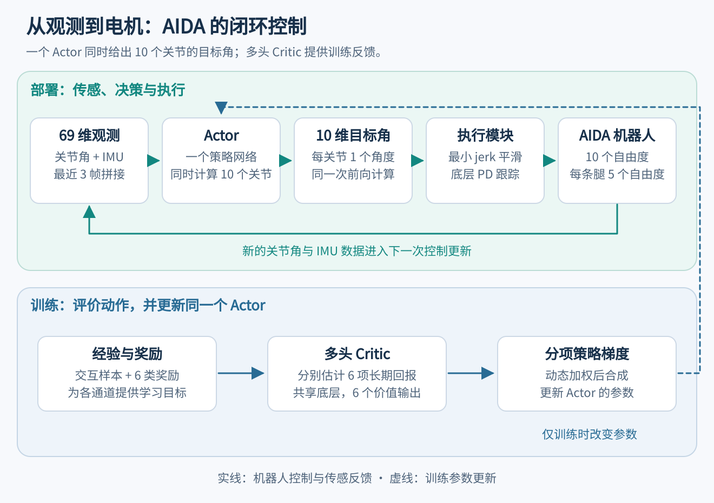
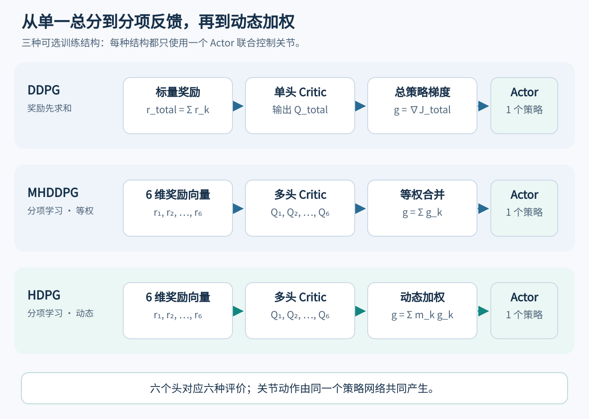
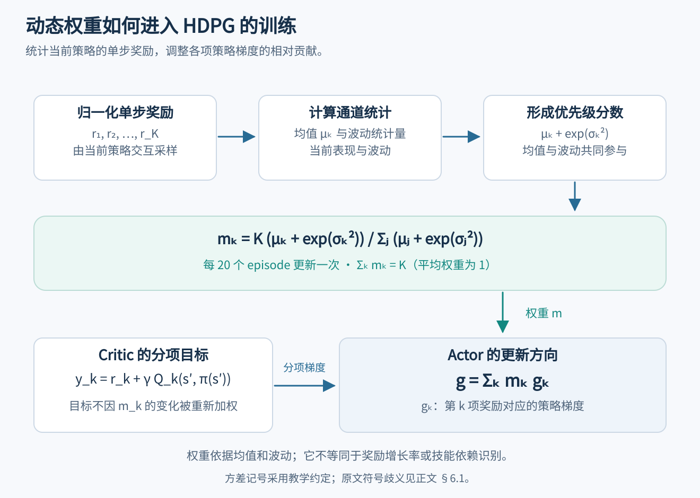
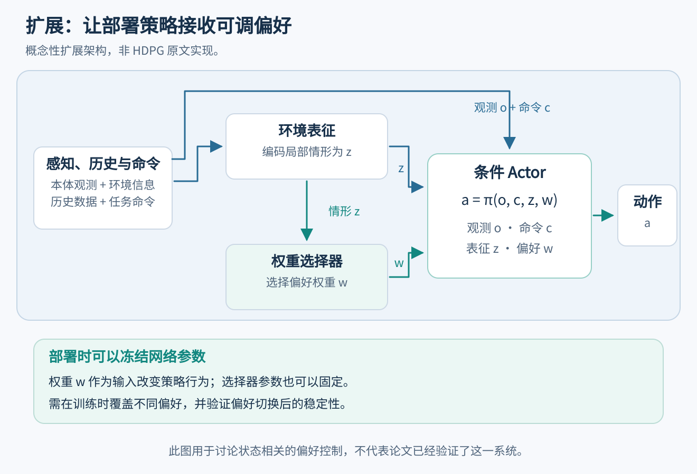

# 从 Actor–Critic 到动态奖励权重：HDPG 双足行走论文精读

**副标题：理解多头价值估计、策略梯度调度，以及它们与多地形自主运动的关系**

整理日期：2026 年 10 月 20 日  
适合读者：了解神经网络与梯度下降、正在入门机器人强化学习的读者  
关键词：双足机器人、Actor–Critic、DDPG、多头 Critic、奖励分解、动态权重、多目标强化学习、地形适应

## 导读

训练一个双足机器人，常常需要同时鼓励前进、维持身体姿态、减少关节力矩并避免跌倒。这些要求可以写成若干奖励项，然后相加。但在训练早期，“向前走”和“先保持站立”可能给出不同的动作调整方向。用一个总分学习价值函数，能否充分利用每个奖励项提供的信息？训练的不同阶段，是否应该给予不同目标不同的学习优先级？

本文精读的 HDPG 论文围绕这两个问题展开。它在 DDPG 框架中，为各奖励分量保留独立的价值输出，再根据奖励统计量，对这些分量产生的策略梯度动态加权。[1](#ref-1)

**理解这篇论文的关键，是把三个层次分开：奖励如何评价行为，Critic 如何估计长期价值，Actor 如何利用梯度改变动作。** HDPG 主要改变后两个层次中的信息组织和更新方式。它没有让机器人自动发明所有奖励，也没有直接提供部署时根据地形修改奖励的完整机制。

下文先从控制闭环和传统 Actor–Critic 讲起，再逐步进入论文公式、实验和客观评价，最后讨论它对多地形运动与自主奖励调节的启发。公式中的数值例子为教学构造；实验数据均单独注明来源。后半部分涉及 2026 年相关工作的内容属于延伸阅读，不属于 HDPG 原论文的贡献。

### 论文信息

| 项目 | 内容 |
|---|---|
| 题目 | *Reward-Adaptive Reinforcement Learning: Dynamic Policy Gradient Optimization for Bipedal Locomotion* |
| 作者 | Changxin Huang、Guangrun Wang、Zhibo Zhou、Ronghui Zhang、Liang Lin |
| 通讯作者 | Liang Lin（林倞） |
| 期刊 | *IEEE Transactions on Pattern Analysis and Machine Intelligence*，简称 TPAMI |
| 正式卷期 | 45(6): 7686–7695，2023 年 6 月 |
| 首次在线发表 | 2022 年 11 月 21 日 |
| DOI | [10.1109/TPAMI.2022.3223407](https://doi.org/10.1109/TPAMI.2022.3223407) |
| 方法简称 | HDPG：Hybrid and Dynamic Policy Gradient |
| 主要平台 | AIDA 双足机器人；补充 MuJoCo 连续控制实验 |
| 项目入口 | [作者团队项目页](https://www.sysu-hcp.net/projects/Robotics/107.html) |

论文于 2022 年在线发表、编入 2023 年卷期，因此不同页面出现这两个年份并不矛盾。正式文献引用采用 2023 年。[1](#ref-1)

## 阅读目录

1. [先理解问题：机器人为什么需要多个奖励？](#sec-1)
2. [基础：传统 Actor–Critic 与 DDPG 怎样训练？](#sec-2)
3. [论文任务：机器人、控制接口和六类奖励](#sec-3)
4. [第一步改动：从单头 Critic 到多头 Critic](#sec-4)
5. [第二步改动：如何组合分项策略梯度？](#sec-5)
6. [第三步改动：动态权重究竟怎样更新？](#sec-6)
7. [为什么学习路径不同，训练效果也会不同？](#sec-7)
8. [把方法串起来：训练流程、网络和复现边界](#sec-8)
9. [实验到底证明了什么？](#sec-9)
10. [作者团队、期刊水平与客观创新评价](#sec-10)
11. [从双足行走走向多地形：固定奖励意味着固定运动吗？](#sec-11)
12. [机器人能否自主调整奖励或目标权重？](#sec-12)
13. [把启发变成研究：问题、架构与公平实验](#sec-13)
14. [精读路线与易混概念](#sec-14)
15. [参考文献](#references)

---

<a id="sec-1"></a>

## 1. 先理解问题：机器人为什么需要多个奖励？

### 1.1 “走起来”包含多个同时存在的要求

只给机器人一个“向前位移越大越好”的奖励，可能会鼓励它猛冲、跳跃，甚至利用仿真漏洞。只强调身体直立，又可能得到一个尽量不动的策略。加上力矩惩罚，机器人还需要在运动能力和动作代价之间作取舍。

因此，常见的奖励形式是：

$$
r_t=\sum_{k=1}^{K} c_k\rho_{t,k}.
$$

其中，$\rho_{t,k}$ 表示第 $k$ 个原始评价项，$c_k$ 是人为指定的系数，$K$ 为评价项数。例如，$\rho_{t,1}$ 可以衡量前进，$\rho_{t,2}$ 可以惩罚身体倾斜。

为避免同一系数在后文重复相乘，我们定义：

$$
r_{t,k}=c_k\rho_{t,k},\qquad r_t=\sum_{k=1}^{K}r_{t,k}.
$$

也就是说，后文所说的“分项奖励”已经包含最初的人为系数。

这些系数决定了评价规则中的取舍，但一个适合最终行走行为的组合，不一定让训练过程最容易。训练早期，策略可能还没有学会维持姿态；此时提高对稳定性的学习关注，可能使它更容易进入能够持续探索步态的状态。这是 HDPG 的出发点。[1](#ref-1)，§1、§4.2。

### 1.2 奖励、长期回报、动作是三个不同对象

对初学者而言，最容易混淆的是“奖励高”和“动作好”之间还隔着一个长期预测问题。

| 对象 | 含义 | 行走中的例子 |
|---|---|---|
| 单步奖励 $r_t$ | 这一步发生后得到的评价 | 这一时刻身体倾斜多少、用了多大力矩 |
| 累计回报 $G_t$ | 从现在开始，未来一串奖励的折扣和 | 这次迈腿是否有助于随后连续行走 |
| 动作 $a_t$ | 控制器此刻向机器人发出的命令 | 同时给出所有关节的目标角度 |
| 价值 $Q^\pi(s,a)$ | 执行动作 $a$，随后遵循策略 $\pi$ 时的期望累计回报 | 当前迈腿方式对未来运动质量的预测 |

折扣回报写作：

$$
G_t=\sum_{\ell=0}^{\infty}\gamma^\ell r_{t+\ell},\qquad 0\leq\gamma<1.
$$

实际回合终止时，求和相应结束。折扣因子 $\gamma$ 调节对更远未来奖励的重视程度。

一个动作可能短期消耗更多力矩，却避免随后跌倒。强化学习的任务是学习这种长期后果，而不是只让当前一步的奖励最大。

### 1.3 本文的基本符号

| 符号 | 含义 |
|---|---|
| $s_t$ | 算法使用的状态输入；实际机器人可能只有不完全观测 |
| $a_t$ | 动作向量 |
| $\pi_\theta$ | 参数为 $\theta$ 的 Actor，即策略网络 |
| $Q_\phi$ | 参数为 $\phi$ 的 Critic，即价值估计网络 |
| $r_{t,k}$ | 已包含人为系数的第 $k$ 项单步奖励 |
| $Q_k$ | 第 $k$ 项奖励对应的长期价值 |
| $g_k$ | 第 $k$ 个价值分量提供的 Actor 参数更新方向 |
| $m_k$ | HDPG 在训练中计算的动态梯度权重 |
| $\mathcal D$ | 经验回放池，存储历史交互数据 |

后文讨论自主偏好时会使用 $w_t$。它表示部署策略接收的偏好输入，与 HDPG 的训练权重 $m_k$ 不是同一个机制。

<a id="sec-2"></a>

## 2. 基础：传统 Actor–Critic 与 DDPG 怎样训练？

### 2.1 Actor 负责动作，Critic 负责评价

Actor–Critic，简称 AC，是一类强化学习结构。Actor 根据状态输出动作或动作分布；Critic 学习估计状态或状态—动作的长期价值，并帮助 Actor 更新。DDPG 是其中一种适用于连续动作的算法；PPO 也经常采用 Actor–Critic 结构，但其策略和更新方式不同。因此，“传统 AC”不能直接等同于某一个具体算法。[2](#ref-2) [3](#ref-3) [4](#ref-4)

HDPG 的主实现以 DDPG 为基础。DDPG 的 Actor 是确定性策略：

$$
a_t=\pi_\theta(s_t).
$$

连续动作意味着关节目标角、力矩或速度可以在连续范围内取值，而不是从“左、右、前、后”几个离散选项中选择。

训练时可以在 Actor 输出上加入探索噪声，使机器人尝试不同动作。机器人执行后，得到下一状态和奖励。这样便形成一条交互记录：

$$
(s_t,a_t,r_t,s_{t+1}).
$$

DDPG 将这些记录存入经验回放池，再抽取小批量数据训练网络。回放减少了对紧邻时序样本的依赖，并使历史数据能够重复利用。[3](#ref-3)

### 2.2 Critic 如何知道自己预测得对不对？

Critic 预测：

$$
Q_\phi(s_t,a_t).
$$

它的监督目标由已经观察到的即时奖励和下一状态的价值估计组成：

$$
y_t=r_t+\gamma Q_{\bar\phi}\!\left(s_{t+1},\pi_{\bar\theta}(s_{t+1})\right).
$$

带横线的参数表示更新较慢的目标网络，用于缓和训练目标自身快速变化带来的不稳定。对于真正的终止状态，未来价值项应按终止处理规则置零；这里先展示非终止转移，避免遮蔽主要结构。

Critic 的损失为：

$$
L_Q(\phi)=\mathbb E_{\mathcal D}\left[(y_t-Q_\phi(s_t,a_t))^2\right].
$$

这不是拿未来真实发生的所有奖励逐一算完后才训练，而是用“当前奖励 + 对后续价值的估计”构造目标，即自举式价值学习。目标网络和经验回放是标准 DDPG 的组成部分；HDPG 原文部分公式省略了这些实现记号。[1](#ref-1) [3](#ref-3)

### 2.3 Actor 的梯度来自哪里？

Actor 希望产生 Critic 认为长期价值更高的动作。对一个状态，链式法则给出：

$$
g(s)=
\left(D_\theta\pi_\theta(s)\right)^{\!\top}
\left.\nabla_aQ_\phi(s,a)\right|_{a=\pi_\theta(s)}.
$$

这条公式可以拆成两步理解。

首先，$\nabla_aQ$ 告诉我们，动作向量向哪个方向微调，会使预测价值上升。其次，$D_\theta\pi$ 告诉我们，怎样改变网络参数，才能让网络输出朝这个动作方向移动。训练中对采样状态求平均，得到更新方向：

$$
g_{\mathrm{DDPG}}=\mathbb E_{s\sim\mathcal D}[g(s)].
$$

Actor 沿该方向做梯度上升；实际软件通常最小化 $-Q$，效果等价。进行 Actor 更新时，Critic 参数保持不变，但梯度仍需要通过 Critic 对动作的导数传到 Actor。这里冻结的是 Critic 的参数更新，而不是切断整个计算链。[2](#ref-2) [3](#ref-3)

### 2.4 先把训练和部署分开

训练时需要奖励、Critic、数据采样和优化器。训练完成后，机器人通常只保留生成动作所需的模块。一个普通的已训练 Actor，不需要每个控制时刻再运行 Critic 才能输出动作。

这一区分会影响我们如何理解论文标题中的 “reward-adaptive”：**训练时自适应地调整学习权重，不等于部署时机器人还在实时改写奖励并重新学习。**

<a id="sec-3"></a>

## 3. 论文任务：机器人、控制接口和六类奖励

### 3.1 AIDA 实际怎样运动？

论文使用 AIDA 双足机器人，共 10 个自由度，每条腿 5 个。单帧状态为 23 维，包含关节角和 IMU 数据；输入策略网络前，将连续三帧拼接为 69 维。Actor 一次输出 10 个关节的目标角度。[1](#ref-1)，§4、§5.2。

为统一后文公式，单帧观测记为 $o_t$，网络状态输入记为 $s_t=(o_{t-2},o_{t-1},o_t)$。Actor 和 Critic 的状态支路都使用这份 69 维输入，不是只有 Actor 看三帧而 Critic 只看一帧。

原文没有逐项列清 23 维状态的完整组成，不能擅自把它补成某一套姿态四元数、线速度和角速度组合。三帧拼接也不同于 LSTM：它给网络一个有限时间窗口，但不是递归记忆结构。

关节目标角并不直接等于最终电机力矩。论文还使用最小 jerk 轨迹生成进行平滑，并通过底层 PD 控制跟踪目标。最小 jerk 中的 jerk 指位置的三阶时间导数；直观作用是避免目标角变化过于突兀。[1](#ref-1)，Fig.1。



*图1：根据论文描述重新绘制的教学示意。Critic 提供训练信号；部署控制链由 Actor、轨迹平滑、底层控制和机器人组成。图中不表示原文未报告的控制频率或 PD 增益。*

一种常见的 PD 形式是：

$$
\tau_i=k_{p,i}(q_i^*-q_i)+k_{d,i}(\dot q_i^*-\dot q_i).
$$

这里仅用于解释位置跟踪如何转化为驱动力矩，不表示论文给出了这些变量的完整实现和增益设置。

### 3.2 六类奖励分别衡量什么？

为统一符号，下表用 $c_1,\ldots,c_5$ 表示原文奖励中的固定系数，用 $\tau_i$ 表示关节力矩。这个符号调整不改变原公式含义。[1](#ref-1)，§4.3，式（11）—（14）。

| 奖励项 | 公式或定义 | 它提供的偏好 |
|---|---|---|
| 步态奖励 $r_t^g$ | 发生步态事件时为 $c_1d_t^g\cos\theta^g$，否则为 0 | 鼓励有组织的支撑交替与步态推进 |
| 每时间步前进奖励 $r_t^s$ | $c_2d_t^s\cos\theta^s$ | 鼓励持续位移与方向一致性 |
| 力矩惩罚 $r_t^\tau$ | $-c_3\sum_i\lvert\tau_{t,i}\rvert$ | 限制过大的关节力矩 |
| 骨盆高度惩罚 $r_t^h$ | $-c_4\lvert h_t-h_0\rvert$ | 使骨盆保持在期望高度附近 |
| 骨盆姿态惩罚 $r_t^o$ | $-c_5(\lvert\mathrm{roll}_t\rvert+\lvert\mathrm{pitch}_t\rvert)$ | 减少身体侧倾和前后倾 |
| 跌倒惩罚 $r_t^d$ | 跌倒时为 $-50$ | 降低跌倒行为的价值 |

实际系数中，力矩项 $c_3=0.001$，其余上述固定系数为 1。[1](#ref-1)，§5.2。

$d_t^g$ 是原文所称一次 gait 的长度，$d_t^s$ 是当前环境时间步的移动距离。$h_t$ 为当前骨盆高度，$h_0$ 为期望高度；roll 和 pitch 分别表示侧倾与前后倾角。

这里有四个值得仔细区分的细节。

**第一，step reward 中的 step 是环境时间步。** 它依据当前时间步的位移计算，不能直接理解成“每迈完一个完整脚步才结算一次”。相对地，gait reward 带有步态事件条件，涉及单支撑与双支撑的时序。论文没有给出完整可执行的步态事件检测程序，因此不能把自行设计的脚接触状态机当作作者原实现。

**第二，方向项的解释需要克制。** 原文把 $\theta^s$ 描述为 $t-1$ 与 $t$ 时刻的机器人方向夹角，把 $\theta^g$ 描述为 $t-T$ 与 $t$ 时刻的方向夹角，其中 $T$ 为该 gait 的时间跨度。其方向定义仍不够细。这里采用“方向一致性因子”的说法，不额外断言它等于位移方向与全局目标方向的夹角。

**第三，力矩惩罚是能耗相关的代理量。** $\sum_i|\tau_i|$ 不是严格的机械功率或能量；机械功率还与关节角速度有关。原文个别叙述使用“反比”，但显示公式是力矩绝对值之和的负值，并没有取倒数。

**第四，不依赖参考步态轨迹仍然可以有很强的先验。** 这些奖励、目标骨盆高度、轨迹平滑和 PD 控制，都向学习系统注入了设计知识。论文的特点是不要求预先给定专家行走轨迹来监督策略，而不是完全没有人为运动知识。[1](#ref-1)

### 3.3 为什么这个任务适合研究奖励分解？

这六个通道的数值尺度、出现频率和学习难度并不相同。身体姿态几乎每时刻都能评价，完整步态事件则可能在策略已有一定能力后才频繁出现；力矩项的量纲和数值范围又不同。

如果只看总分，读者很难知道分数上升到底来自前进增加，还是身体更稳定。保留分项价值，首先让学习系统能够分别估计这些长期后果，随后才谈得上对其学习方向赋予不同权重。

<a id="sec-4"></a>

## 4. 第一步改动：从单头 Critic 到多头 Critic

### 4.1 传统方法学习一个总价值

当奖励已经相加为 $r_t=\sum_kr_{t,k}$ 时，传统单头 DDPG 学习一个标量 $Q(s,a)$。这个标量表示，在既定奖励规则下，当前动作的总体长期价值。

HDPG 则保留奖励向量：

$$
\mathbf r_t=(r_{t,1},\ldots,r_{t,K}),
$$

并令 Critic 输出：

$$
\mathbf Q_\phi(s,a)=\big(Q_{\phi,1}(s,a),\ldots,Q_{\phi,K}(s,a)\big).
$$

对 AIDA 而言，$K=6$。同一个状态、同一个完整动作，会同时得到六个价值预测：它对步态、前进、力矩、骨盆高度、姿态和跌倒风险分别有怎样的长期影响。[1](#ref-1)，§4.1。

### 4.2 六个头都在评价同一个后续策略

第 $k$ 个头的目标为：

$$
y_{t,k}=r_{t,k}+\gamma Q_{\bar\phi,k}\!\left(s_{t+1},\pi_{\bar\theta}(s_{t+1})\right).
$$

所有头共用下一状态的 Actor 动作。它们回答的是：**如果随后继续执行同一个整体策略，各分项奖励分别会获得多少回报？**

这和每个头都各自选择最有利于自己的未来动作不同。例如，不能将上式直接改成：

$$
y_{t,k}=r_{t,k}+\gamma\max_a Q_k(s_{t+1},a),
$$

然后认为含义不变。这个表达允许“节省力矩头”想象未来总是少动，又允许“快速前进头”想象未来总是猛冲；这些设想未必来自同一个可执行策略。

多头 Critic 的损失是各分项误差平方之和：

$$
L_C(\phi)=\mathbb E_{\mathcal D}\left[\sum_{k=1}^{K}
\big(y_{t,k}-Q_{\phi,k}(s_t,a_t)\big)^2\right].
$$

这里仍采用标准 DDPG 的目标网络记号来帮助理解；原文式（5）—（8）省略了部分记号。[1](#ref-1)

### 4.3 奖励相加在数学上有错吗？

没有。对**同一策略、相同折扣因子和固定线性奖励组合**，期望的线性性质给出：

$$
Q^\pi_{\sum r}(s,a)=\sum_{k=1}^{K}Q^\pi_k(s,a).
$$

如果把固定系数放在奖励外面，则相应写成 $Q^\pi_{\sum c_k\rho_k}=\sum_kc_kQ^\pi_{\rho_k}$。这一点在奖励分解相关前作中已有明确讨论。[6](#ref-6)

所以，如果一个标量 Critic 能精确估计预先定义的总价值，它完全可以支持正确的优化。不能从论文的动机推出“总奖励必然错误”或“求和后就不可能找到好策略”。

多头结构的价值主要发生在实际学习条件下：神经网络近似有误差、数据有限、各分项尺度不同，而且研究者希望保留调整不同目标的接口。

### 4.4 分项监督为什么仍可能更有帮助？

考虑一个教学例子：假设两项价值预测的误差分别为 $+3$ 和 $-3$。若总价值通过两项相加得到，则总预测误差为 0：

$$
L_{\mathrm{sum}}=(3-3)^2=0.
$$

而分项损失为：

$$
L_{\mathrm{heads}}=3^2+(-3)^2=18.
$$

分项监督会继续纠正两个通道的误差，因为它需要每项都能解释清楚。总价值监督只关心总和是否准确，在这个例子中不再产生纠正信号。

这个例子说明两种损失保留的监督信息不同，并不证明单头 Critic 总会发生隐藏错误：真实单头网络未必显式表示这两个分量；如果任务只需要总价值，误差抵消也未必有害。多头可能改善表示和优化，但也增加了拟合各分项的要求，且共享特征仍可能相互干扰。

### 4.5 多头不是多个机器人控制器

本文 Critic 使用共享网络和多个输出头。六个头不是六个完全独立的网络，也不对应六个关节。Actor 仍然只有一个，每次同时输出全部十个关节目标角。

奖励通道按“评价标准”划分，动作维度按“关节控制变量”划分。两者之间通常是多对多关系：为了提高身体稳定性，可能需要同时调整髋、膝和踝；为了减少力矩，也可能需要重新组织整个步态。

<a id="sec-5"></a>

## 5. 第二步改动：如何组合分项策略梯度？

### 5.1 每个价值头都能给 Actor 一个更新方向

第 $k$ 个头提供：

$$
g_k=\mathbb E_{s\sim\mathcal D}\left[
\left(D_\theta\pi_\theta(s)\right)^{\!\top}
\left.\nabla_a Q_{\phi,k}(s,a)\right|_{a=\pi_\theta(s)}
\right].
$$

它是与 Actor 参数 $\theta$ 同维度的向量，表示怎样改变整套策略网络参数，会提高该分项的预测价值。

如果各通道等权组合，得到：

$$
g_{\mathrm{MH}}=\sum_{k=1}^{K}g_k.
$$

这对应论文用于消融的 MHDDPG。它已经使用多头价值监督，但没有动态优先级，所有 $m_k=1$。

HDPG 进一步采用：

$$
\boxed{g_{\mathrm{HDPG}}=\sum_{k=1}^{K}m_k g_k.}
$$

每个 $m_k$ 在当前 Actor 更新时作为给定系数使用。优化器可以通过对 $\sum_km_kQ_k(s,\pi_\theta(s))$ 求导，一次完成这个加权过程；概念上分开写，并不要求真的启动六次独立控制决策。[1](#ref-1)，式（8）—（10）。

### 5.2 一张表区分三个方法

| 维度 | DDPG | MHDDPG | HDPG |
|---|---|---|---|
| 奖励进入价值学习的形式 | 先相加为总奖励 | 保留各分项 | 保留各分项 |
| Critic 输出 | 一个总价值 | 多个分项价值 | 多个分项价值 |
| Critic 监督 | 总价值误差 | 各分项误差之和 | 各分项误差之和 |
| Actor 更新 | 总价值的梯度 | 分项梯度等权相加 | 分项梯度按 $m_k$ 动态加权 |
| 动态统计模块 | 无 | 无 | 根据归一化奖励均值和方差算权重 |
| 部署动作网络 | 一个 Actor | 一个 Actor | 一个 Actor |



*图2：三者的主要区别在训练评价和 Actor 更新路径。所有方法都可以在部署时由一个 Actor 输出联合动作。*

这里的差别并不是“传统算法只更新 Actor，本文才更新 Critic”。三者都会训练 Actor 和 Critic。论文改变的是 Critic 如何组织监督，以及 Actor 接收怎样的合成梯度。

### 5.3 一个数值例子：权重可以改变更新方向

假设只观察 Actor 参数空间中的一个方向，并考虑两个目标：

$$
g_{\mathrm{balance}}=-3,\qquad
g_{\mathrm{forward}}=+4.
$$

负号和正号仅表示对这个参数方向的偏好，不是关节力矩或身体前进方向。

等权相加得到：

$$
g_{\mathrm{fixed}}=-3+4=+1.
$$

如果动态权重为 1.2 和 0.8：

$$
g_{\mathrm{dynamic}}=1.2(-3)+0.8(4)=-0.4.
$$

更新方向发生了反转。可见动态权重不仅改变“学习快慢”，还可能改变这一阶段的学习取舍。

当然，真实梯度位于高维参数空间。某两个通道可能同向、正交或冲突，并且每次更新都在变化。这个例子只是说明机制，不代表论文实验中测量到的梯度。

### 5.4 它是否解决了多目标梯度冲突？

HDPG 没有显式计算两个梯度的夹角，也没有进行梯度投影或约束求解。因此，不能把它描述为已经系统解决了梯度冲突。

PCGrad 等方法会直接处理多任务梯度之间的关系，属于另一类设计。[24](#ref-24) 对固定总目标而言，分项梯度抵消本身也可能反映合理取舍。是否有害，需要结合目标、梯度尺度和局部优化条件判断。

<a id="sec-6"></a>

## 6. 第三步改动：动态权重究竟怎样更新？

### 6.1 原文式（9）的准确形式

论文先把各分项的单步奖励归一化，再根据当前策略采样的奖励统计量计算权重：

$$
\boxed{
m_k=
\frac{K\big(\mu_k+\exp(\sigma_k^2)\big)}
{\displaystyle\sum_{j=1}^{K}\big(\mu_j+\exp(\sigma_j^2)\big)}.
}
$$

其中，$\mu_k$ 是第 $k$ 个归一化单步奖励的样本均值，$K$ 为奖励分量数。原文文字把 $\sigma_k$ 称为 variance，而式（9）写成 $\exp(\sigma_k^2)$，存在符号不一致。[1](#ref-1)，§4.2。

**本文以下教学计算采用常见记号约定：$\sigma_k^2=\operatorname{Var}[\widetilde r_k]$。** 这不能据此确认作者代码到底使用“方差的指数”还是按文字定义实现了“方差平方的指数”。保留原式、指出歧义，比擅自替作者确定实现更稳妥。无论采用哪种解释，这个量都不是奖励增长率。

**动态权重不是一个通过反向传播训练出来的独立网络。** 它由作者事先设计的统计公式计算，实验中每 20 个 episodes 更新一次。Episode 指一个交互回合，不是一个环境时间步。[1](#ref-1)，§5.2。

### 6.2 为什么要先归一化？

力矩、位移、姿态和跌倒惩罚的数值尺度不同。如果直接比较原始均值，数值大的量纲可能占据优势。论文采用 min–max 归一化：

$$
\widetilde r_{t,k}=
\frac{r_{t,k}-r_{\min,k}}{r_{\max,k}-r_{\min,k}}.
$$

上下界依据奖励与物理范围确定。以步态项为例，原文给出对称范围：

$$
r_{\max,g}=c_1d^g_{\max},\qquad
r_{\min,g}=-c_1d^g_{\max}.
$$

统计均值可以写作：

$$
\mu_k=\frac1N\sum_{n=1}^{N}\widetilde r_{n,k}.
$$

原文没有完整报告所有通道的具体上下界、统计样本数 $N$ 以及精确窗口管理方式，因此不能把某个自选窗口或方差估计器称为作者的确定实现。[1](#ref-1)，§5.2。

还要区分归一化的位置：论文明确用归一化奖励来计算动态权重统计量。不能据此自行推断所有 Critic 的奖励标签都经过同样的归一化，更不能把 $m_k$ 无意中同时乘到 Critic 标签和 Actor 梯度两处。

### 6.3 这条规则的直觉是什么？

作者希望训练优先利用较容易获得反馈的目标，同时关注表现仍有波动的分量。

| 统计现象 | 在公式中的作用 | 作者的直觉解释 | 需要保留的限制 |
|---|---|---|---|
| $\mu_k$ 较高 | 增大未归一化分数 | 该项较容易获得回报，可优先学习 | 高均值不等于学习进展快 |
| $\sigma_k^2$ 较高 | 通过指数项增大分数 | 该项表现仍不稳定，值得关注 | 方差也可能来自噪声或环境变化 |
| 分母做整体归一化 | 形成相对权重 | 控制各通道权重的总体尺度 | 不会固定合成梯度的范数 |

例如，某一阶段身体高度和姿态已经比较容易改善，而有规律的步态还很少出现，作者希望调权机制能帮助策略先巩固有用的基础行为。这是一种课程学习式的动机；课程学习本身是已有研究方向。[23](#ref-23)

但公式并没有直接测量“是否掌握平衡”，也没有测量回报的时间增长率。均值是当前表现的统计量，不能自动解释为学习进度。

### 6.4 两个直接性质

在有效归一化范围内，该规则给出正权重，且：

$$
\sum_{k=1}^{K}m_k=K.
$$

所以权重的平均值为 1，而不是总和为 1。AIDA 有六个头，动态权重之和为 6。

对固定的 $K$，平均权重保持为 1，与所有 $m_k=1$ 的消融基线具有相同的权重总量。改变通道数时，总和 $K$ 本身也会改变，因此不能据此保证不同通道数下的更新尺度可直接比较。而且：

$$
\left\|\sum_km_kg_k\right\|
$$

还取决于各梯度的大小和方向，因此合成更新的幅度仍可能改变。

各权重为正还意味着，这个机制主要是连续调节关注程度，并没有把某些技能彻底关闭、等另一技能完成后再打开的显式门控。

### 6.5 用原公式算一次

取一个两目标教学例子：

$$
K=2,\qquad(\mu_1,\mu_2)=(0.8,0.2),\qquad
(\sigma_1^2,\sigma_2^2)=(0,0).
$$

因为 $e^0=1$：

$$
m_1=\frac{2(0.8+1)}{(0.8+1)+(0.2+1)}=1.2,
$$

$$
m_2=\frac{2(0.2+1)}{(0.8+1)+(0.2+1)}=0.8.
$$

这正好得到上一节改变梯度方向的权重。注意，0.8 和 0.2 是归一化后的统计数值，不应直接对应“站稳了”或“完全没有前进”等具体物理状态。



*图3：动态权重通过奖励统计量间接影响 Actor 更新。各 Critic 仍然学习各自的奖励分量。*

### 6.6 “先学会平衡，再自动转向行走”是否由公式保证？

不保证。下面按第 6.1 节的方差记号约定给出一个反例。设有平衡与前进两个归一化奖励，前进项统计量不变：

| 阶段 | 平衡均值 | 平衡方差 | 前进均值 | 前进方差 | 算得平衡权重 |
|---|---:|---:|---:|---:|---:|
| 先前 | 0.80 | 0.08 | 0.20 | 0.04 | 约 1.2056 |
| 后来 | 0.95 | 0.01 | 0.20 | 0.04 | 约 1.2247 |

虽然平衡项的波动降低了，但均值提高得更多，最终平衡权重反而上升。于是，“一个目标更稳定后，权重必然下降并转移给其他目标”并不是该公式的性质。

即使某个权重较大，它的实际更新贡献也可能变小，因为对应 $g_k$ 可能已很小。最终作用取决于 $m_kg_k$，不能只看权重曲线。

因此，更准确的表述是：**HDPG 提供了一个受课程学习启发的软性优先级调度规则；它在实验中改善了学习过程，但没有建立严格的技能完成顺序或因果依赖模型。**

### 6.7 权重“合理”到什么程度？

它的合理性主要来自设计直觉和实验效果，而不是某条唯一最优的推导。仍有几个待验证的问题：

- 奖励方差上升时，增加关注是否总是合适，还是有时只是在追逐噪声？
- 同样的均值和方差，是否可能对应截然不同的运动状态？
- 更换归一化边界，会在多大程度上改变课程顺序？
- 仅用均值、仅用方差、使用学习进展或直接分析梯度，效果如何？
- 权重的更新间隔和统计窗口是否影响稳定性？

原文没有系统给出上述各项消融，也没有展示详细的实际权重随训练变化曲线。因此，可以认可这套机制的实用贡献，但不能把某一种统计直觉当作已经充分验证的普遍规律。[1](#ref-1)

<a id="sec-7"></a>

## 7. 为什么学习路径不同，训练效果也会不同？

### 7.1 “最后都是学会走路”包含三种不同含义

讨论训练路径之前，需要明确“目标相同”究竟指什么。

| 层次 | 例子 | 能否推出优化完全相同？ |
|---|---|---|
| 自然语言任务相同 | 两种方法都希望机器人走起来 | 不能，速度、稳定性和代价的取舍可能不同 |
| 固定数学目标相同 | 两者最终都最大化同一个 $J_{\mathrm{eval}}$ | 仍不能保证有限训练后得到同样策略 |
| 达到相同全局最优值 | 两者都精确求解同一个优化问题 | 最优值相同，但最优策略仍可能不唯一 |

HDPG 保留了原来的评价分量，却在训练时改变它们进入 Actor 更新的相对比例。原文没有规定权重最终一定恢复为 1，也没有安排最后一段固定目标微调。因此，不能默认它只是“绕一条路，最后严格回到原始等权目标”。

### 7.2 当前一步究竟在优化什么？

为了讨论方向，先用理想化的 $\nabla_\theta J_k$ 表示各目标的真实梯度，暂时不考虑 Critic 估计误差和离策略采样偏差。固定评价目标为：

$$
J_{\mathrm{eval}}(\theta)=\sum_kJ_k(\theta).
$$

固定权重方向是：

$$
g_{\mathrm{fixed}}=\nabla_\theta J_{\mathrm{eval}}=\sum_k\nabla_\theta J_k.
$$

如果当前权重固定，HDPG 使用的方向可以理解为当前加权目标的梯度：

$$
g_{\mathrm{dynamic}}=\sum_km_{k,t}\nabla_\theta J_k.
$$

它优化的是这个时刻的取舍。下一次权重改变后，取舍也会改变。

做一次足够小的普通梯度步，固定评价目标的一阶变化近似为：

$$
\Delta J_{\mathrm{eval}}
\approx\alpha\,g_{\mathrm{fixed}}^{\top}g_{\mathrm{dynamic}}.
$$

即使每个 $m_k$ 都为正，两个合成方向的内积也未必为正。第 5.3 节的标量例子中，$g_{\mathrm{fixed}}=1$，$g_{\mathrm{dynamic}}=-0.4$，于是这一步可能降低原始等权目标。

这不说明动态方法一定更差，而是说明“每步都增加原始总回报”不是它天然具有的保证。它可能接受某些阶段性的取舍，换取更有利的后续学习条件。实际实现使用 Adam、近似 Critic 和采样梯度，情况还会更复杂。

> **进阶说明。** 如果将 $m_k$ 视作依赖策略参数的函数，那么对 $\sum_km_k(\theta)J_k(\theta)$ 完整求导，还会出现 $\sum_kJ_k\nabla_\theta m_k$。HDPG 的统计调权没有计算这部分。因此，不宜将它不加说明地称为某个固定全局目标的精确梯度更新。

### 7.3 强化学习中的路径会改变后续数据

监督学习中，训练数据往往已经给定。强化学习中，当前策略还决定下一批数据从哪里来。

设想一个教学场景：策略稍微改善了平衡，因此能更长时间保持有效接触，随后有机会经历连续迈步。于是回放池中开始出现此前很少见的状态转移，Critic 才有数据学习这些动作的长期后果。反过来，如果探索动作持续破坏支撑，数据可能长期集中在失稳附近。

这里的因果链是：

$$
\text{更新方向}
\longrightarrow\text{策略行为}
\longrightarrow\text{访问状态与数据分布}
\longrightarrow\text{下一阶段的价值估计和探索}.
$$

这个例子说明训练路径为何可能影响样本效率，并不声称 HDPG 原文精确定义了某种跌倒终止机制或证明了这条完整因果链。

### 7.4 即使最后恢复同一目标，结果也未必相同

神经网络优化具有非凸性，强化学习还包含函数逼近误差、探索随机性和有限交互预算。不同早期策略可能进入不同的数据区域，形成不同的动作模式，再在有限预算内停留在不同的解附近。

因此，改变学习路径可能影响：

- **样本效率**：达到共同性能阈值需要多少环境交互。
- **训练成功概率**：在多个随机种子下，有多少次能学出可用运动。
- **最终运动取舍**：速度、动作幅度、力矩、稳定性和步态可能不同。
- **分布外表现**：所学行为是否依赖狭窄的训练条件。

最后一项需要专门测试。训练更快或训练回报更高，本身都不能推出鲁棒性更好。

若要验证“动态调权只是帮助找到更好的优化路径”，可以增加一个动态训练后恢复固定权重的实验，再与全程固定权重比较。这个对照是由本文分析提出的研究建议，并非原论文已经完成的结论。

<a id="sec-8"></a>

## 8. 把方法串起来：训练流程、网络和复现边界

### 8.1 一次完整的 HDPG 学习循环

下面是依据论文主机制、结合标准 DDPG 记号整理的教学伪代码。它帮助理解数据流，不等于作者公开源码，也没有补造原文未报告的采样窗口和终止阈值。

```text
初始化 Actor、多头 Critic、目标网络和经验回放池
将所有动态权重 m[k] 初始化为 1（教学选择，原文未明确报告初值）

重复进行训练回合：
    拼接近期观测，得到策略输入
    Actor 输出联合动作，训练时加入探索
    执行动作，记录下一观测和完整分项奖励向量
    将转移存入回放池

    抽取小批量转移：
        用同一个目标 Actor 生成下一状态的动作
        每个 Critic 头计算自己的分项目标 y[k]
        最小化所有分项 TD 误差平方之和

        暂时固定 Critic 参数与当前 m[k]
        最大化加权价值 sum_k m[k] * Q[k](s, Actor(s))
        更新目标网络

    每 20 个回合：
        根据当前策略的归一化奖励样本估计均值和方差
        按论文式（9）重新计算 m[k]

训练结束：
    部署 Actor 与所需的观测处理、轨迹平滑和底层控制
```

Critic 每个头始终预测自己的奖励分量，动态 $m_k$ 加在 Actor 目标上。这使得调权不必直接改写各头的即时奖励定义。不过，Actor 在变化，后续策略价值也会随之变化，因此不能说 Critic 从此面对完全静止的学习目标。

### 8.2 原文明确报告的网络与超参数

| 项目 | 论文配置 |
|---|---|
| Actor 输入 | 连续三帧状态拼接，共 69 维 |
| Actor 网络 | $69\rightarrow128\rightarrow256\rightarrow10$ |
| Critic 状态支路 | $69\rightarrow128$ |
| Critic 动作支路 | $10\rightarrow128$ |
| Critic 合并后 | 拼接为 256 维，再经 $256\rightarrow256\rightarrow6$ |
| 折扣因子 | $\gamma=0.99$ |
| Actor 学习率 | $10^{-5}$ |
| Critic 学习率 | $10^{-4}$ |
| 小批量大小 | 64 |
| 优化器 | Adam |
| 动态权重调整间隔 | 每 20 个 episodes |

来源：原论文 §5.2。[1](#ref-1)

网络结构再次表明，这是一个共享特征、输出六项价值的 Critic。增加几个价值输出通常不会让部署 Actor 成倍变大，但训练开销仍须实测；样本效率、每秒训练速度和总训练时间是不同指标。

### 8.3 如何延伸到 PPO？

论文还验证了 HD-PPO，说明奖励分解和动态组合并不只与确定性 Actor 绑定。[1](#ref-1)，§5.4、Fig.5、§6–7。

在常见 PPO 的 Actor–Critic 实现中，价值网络可以估计各分项的状态价值，并构造相应的优势估计，再按权重影响策略优化。PPO 的概率比和裁剪目标使其具体实现不同于 DDPG 的 $\nabla_aQ$ 链式求导。[4](#ref-4)

因此，可以理解为“同一思想移植到另一种策略更新框架”，但不应把 DDPG 的梯度公式原样称作 PPO 公式。论文没有详尽展开 HD-PPO 的全部工程细节，复现时仍需核对优势归一化、裁剪和加权的具体位置。

### 8.4 哪些细节仍不足以直接复现？

正文提供了核心机制和主要网络配置，但没有完整列出所有实现选择，包括奖励统计样本数、各项归一化边界、完整状态字段、步态事件检测细节、底层控制参数和部分终止处理等。

截至本次整理，在核查的作者主页与项目页中未确认到完整的 HDPG＋AIDA 训练和硬件控制源码入口；这不等于证明任何地方都不存在代码。MuJoCo 基线引用某个开源框架，也不等于作者已经发布自己的完整实现。[1](#ref-1) [20](#ref-20) [22](#ref-22)

复现时应把新增实现选择明确记录下来，而不是用“采用论文默认设置”掩盖原文没有交代的部分。

<a id="sec-9"></a>

## 9. 实验到底证明了什么？

### 9.1 先拆开两个改动的贡献

论文比较 DDPG、MHDDPG 和 HDPG，这个设置有价值，因为它至少区分了“多头分项监督”和“进一步动态加权”。

若只比较 HDPG 与原始 DDPG，就无法判断提升来自哪一部分。看消融时，应先比较 DDPG 与 MHDDPG，再比较 MHDDPG 与 HDPG。

### 9.2 AIDA：学习起效更早，但不能直接称为全程六倍提速

论文对 Fig.3 的说明给出了累计奖励开始明显上升的大致交互步数：

| 方法 | 奖励开始明显上升的步数 |
|---|---:|
| DDPG | 约 1.5M |
| MHDDPG | 约 1.0M |
| HDPG | 约 0.25M |

这里 M 表示百万环境交互步。结果支持 HDPG 在该实验中更早进入有效学习阶段。[1](#ref-1)，Fig.3、§5.4。

但 $1.5/0.25=6$ 不是严格的完整训练加速比。这些位置是“曲线开始上升”，不是统一性能阈值对应的耗样本量，也不是墙钟时间。更可靠的效率报告应指定共同阈值、计入全部训练成本，并跨随机种子统计。

分项奖励曲线中，高度和姿态相关表现先改善，步态与前进相关回报随后提高。这与作者提出的课程式解释相容，但没有实际 $m_k(t)$、梯度和行为中介分析，仍不足以单独证明“式（9）发现了平衡到行走的因果依赖”。原文 AIDA 曲线阴影的统计定义和独立训练种子数也没有清楚交代。[1](#ref-1)，Fig.3、§5.4.4。

### 9.3 仿真鲁棒性：有针对性的测试，范围有限

| 测试 | 原文设置 | 结果能说明的范围 |
|---|---|---|
| 外力扰动 | 6–14 N，持续 0.2 s，前后及侧向；每项测试 100 次试验 | 该仿真扰动范围内的行走恢复能力 |
| 障碍地形 | 高度 0.6–1.4 cm | 小尺度障碍下的通过或持续行走能力 |
| 坡地 | 坡度 3–15° | 指定坡度范围的仿真表现 |
| 地形成功判断 | 稳定行走 10 s | 有限测试时长下的成功率 |

这些扰动、障碍和坡度用于测试，不能把它们写成论文已经训练了复杂地形课程。障碍单位是 **厘米**，不是米。[1](#ref-1)，§5.3、Fig.6–7。

原文报告 HDPG 的总体抗扰与地形表现优于其对照。例如，1.2 cm 障碍时成功率超过 60%，1.4 cm 时约 40%；12° 坡地上相对对照约高 20 个百分点。这些是作者文字或图示中的近似量，不宜进一步计算成高精度统计结论。[1](#ref-1)

测试支持“方法在有限的未训练扰动与地形条件中表现更好”，还不能推出任意地形泛化，更不能把仿真坡地成功率直接当作实机能力。

### 9.4 实机：完成了什么验证？

论文将仿真学习得到的策略迁移到真实 AIDA，展示了平地行走和手推扰动后的恢复。所报告的域随机化主要作用于骨盆质心在水平 $x/y$ 方向的位置。[1](#ref-1)，§5.5、Fig.8。

这说明方法不只停留在模拟动画，也有初步硬件可行性。但实机部分没有提供完整的多方法成功率对比、标定推力、重复次数和误差统计。原文结论也把真实障碍与坡地场景列为后续工作。[1](#ref-1)，§7。

因此，这一部分适合评价为“完成初步 sim-to-real 与抗扰展示”。若说已经全面解决真实复杂地形上的鲁棒双足运动，就超过了证据范围。

### 9.5 增加奖励项：可以比较算法，不能跨行直接比较总分

论文进一步增加速度与接触相关奖励，考察 6、7、8 项奖励下的表现。Fig.9 给出的累计回报如下：[1](#ref-1)

| 奖励项数 | DDPG | MHDDPG | HDPG |
|---:|---:|---:|---:|
| 6 | 720 | 1250 | 1500 |
| 7 | 890 | 1430 | 1810 |
| 8 | 950 | 1620 | 2030 |

同一行中，奖励定义相同，可以比较算法表现。不同的行增加了奖励项，总分含义已经变化，因此不能仅凭 2030 高于 1500 就断言八奖励机器人在物理意义上更强。这组实验主要支持方法能够扩展到更多奖励通道。

### 9.6 MuJoCo：应当看均值、波动和合适的对照

Table 1 实际列出四个任务，正文个别地方写成“三个”应视为编辑笔误。实验使用 1M 环境交互步预算，报告 10 次运行的均值与标准差。[1](#ref-1)，§6、Table 1。

| 方法 | Hopper | Walker2d | HalfCheetah | Humanoid |
|---|---:|---:|---:|---:|
| DDPG | 3476.5 ± 98.0 | 2398.5 ± 1169.7 | 12422.9 ± 620.4 | 177.3 ± 77.6 |
| MHDDPG | 3539.3 ± 23.9 | 3162.0 ± 1263.8 | 12748.9 ± 501.8 | 513.6 ± 131.0 |
| HDPG | 3600.4 ± 30.5 | 3217.5 ± 1144.8 | 12895.3 ± 528.1 | 601.7 ± 159.1 |
| PPO | 2609.3 ± 700.8 | 3588.5 ± 756.6 | 5783.9 ± 1244.0 | 787.2 ± 160.3 |
| HD-PPO | 3263.5 ± 367.8 | 4688.0 ± 220.1 | 6165.2 ± 150.4 | 996.4 ± 149.6 |

下面的增幅由表中均值计算，不是新的独立实验，也不是显著性检验：

| 对比 | Hopper | Walker2d | HalfCheetah | Humanoid |
|---|---:|---:|---:|---:|
| HDPG 相对 DDPG | +3.56% | +34.15% | +3.80% | +239.37% |
| HDPG 相对 MHDDPG | +1.73% | +1.76% | +1.15% | +17.15% |
| HD-PPO 相对 PPO | +25.07% | +30.64% | +6.59% | +26.58% |

这张表值得读出五点。

**第一，多头监督贡献不能被动态权重全部“拿走”。** 在前三个任务中，HDPG 相对 MHDDPG 的额外均值增益约为 1%–2%；DDPG 到 HDPG 的总提升包含了两个结构变化。

**第二，标准差影响结论强度。** Walker2d 的波动较大，仅凭均值不能宣布所有方法差异均统计显著。

**第三，很大的百分比可能来自很低的基线。** Humanoid 中 HDPG 相对 DDPG 的增幅很大，但 DDPG 起点仅 177.3。应同时看绝对分数和其他基线。

**第四，HDPG 并非击败表中所有方法。** 原始 PPO 在 Walker2d 和 Humanoid 上已经高于 HDPG。这个结果仍可支持 HDPG 改善 DDPG，却不能支持“所有连续控制算法中最好”。

**第五，PPO 的表格消融不完整。** Table 1 没有 MH-PPO，因此不能只用该表拆出 PPO 中动态权重的独立贡献；AIDA 的 Fig.5 则包含 PPO、MH-PPO 和 HD-PPO 曲线。

不同 MuJoCo 环境的奖励定义也不同，不能将 HalfCheetah 的高分与 Humanoid 的低分直接解释为能力高低。

<a id="sec-10"></a>

## 10. 作者团队、期刊水平与客观创新评价

### 10.1 这项工作来自怎样的团队？

论文主要由中山大学团队完成，作者中包含论文署名时在牛津大学工程科学系工作的 Guangrun Wang。通讯作者为中山大学的 Liang Lin（林倞）。下面按正式论文的作者单位与文末简介整理，描述的是论文时期的身份，不直接当作 2026 年的现职信息。[1](#ref-1)

| 作者 | 论文时期的单位与身份 | 与理解论文相关的背景 |
|---|---|---|
| Changxin Huang | 中山大学智能工程学院；论文简介为博士生 | 第一作者，博士阶段导师为林倞，研究涉及强化学习与机器人 |
| Guangrun Wang | 牛津大学工程科学系；论文简介为博士后研究人员 | 具有机器学习与表示学习研究背景；此前在中山大学获得博士学位 |
| Zhibo Zhou | 中山大学计算机学院；论文简介为硕士生 | 研究涉及强化学习与机器人，导师为林倞 |
| Ronghui Zhang | 中山大学智能工程学院；论文简介为副教授 | 研究涉及计算机视觉、智能控制和交通系统 |
| Liang Lin（林倞） | 中山大学计算机学院教授；通讯作者 | 研究涉及机器学习、视觉及相关智能系统 |

第一作者主页与林倞的团队主页可以补充研究背景；其中个人主页保留的学生身份可能已经过时，不能据此更新作者当前履历。[20](#ref-20) [21](#ref-21)

从单位和研究方向看，这是一项以机器学习方法为主线、结合机器人平台验证的合作工作。这个背景有助于理解论文为何把重点放在奖励信息如何进入价值学习和梯度更新，而不是机械本体设计或经典步态控制理论。

不过，原文没有提供细到“谁提出算法、谁搭建硬件、谁完成全部实验”的贡献声明。作者顺序和研究背景不能替代这种证据。对团队能力的评价，也不应直接替代对本篇方法和实验的判断。

### 10.2 TPAMI 是什么水平的期刊？

TPAMI 是计算机视觉、模式识别与机器智能方向的重要高水平期刊。在 CCF 官方人工智能期刊目录中，它列为 A 类。[18](#ref-18) IEEE 官方范围说明涵盖视觉与图像理解、模式分析与识别，以及部分机器智能领域，并强调面向模式分析的机器学习。[19](#ref-19)

因此，把它理解为相关计算机学科中的顶级期刊之一是合适的。这说明论文通过了高水平学术期刊的评审，也说明其方法贡献被认为具有一定普适研究价值。

但期刊定位需要结合学科理解。TPAMI 并非专门围绕足式机器人硬件可靠性、接触建模或控制理论证明组织所有稿件。发表在 TPAMI，不能自动推出一项机器人方案已经达到部署成熟度，也不能替代对实验范围的检查。

影响因子、JCR 分区和其他目录具有具体年份与口径。本文不混用某个作者网页上的旧影响因子来代表当前指标。对精读而言，官方学科定位、可核实的目录等级，以及论文自身的证据更有帮助。

### 10.3 哪些思想已有前作？

HRA 在 2017 年已经研究了奖励分解与分项价值学习。[5](#ref-5) drQ 在 2019 年讨论了共同策略下的价值分解，用统一的动作选择来组织分项价值更新。[6](#ref-6) 因此，不能将“把奖励分开”“为奖励设置多个价值头”或“分项价值应对应共同策略”全部视为 HDPG 首次提出。

不同奖励分解前作还包含不同变体，对未来策略的设定并不完全相同。阅读论文对前作的批评时，应具体核对其针对的版本，不能把所有 HRA 类方法都概括成“每个头各自幻想自己的最优策略”。

HDPG 的主要新增内容，是把分项价值和策略梯度组织到连续动作 Actor–Critic 框架中，再提出依据奖励统计量动态调节梯度权重的具体方法，并在双足机器人和其他连续控制任务中验证。[1](#ref-1)

### 10.4 如何评价创新含量？

下面是基于方法与证据的评价，不是期刊给出的官方评分。

| 评价维度 | 本文贡献 | 评价边界 |
|---|---|---|
| 问题建模 | 将多种运动要求作为独立价值通道保留 | 奖励分解本身已有明确前作 |
| 学习结构 | 共享多头 Critic、共同后续策略、分项 Actor 梯度 | 属于对既有 AC 思路的组织与扩展 |
| 动态机制 | 提出均值和波动统计驱动的梯度权重 | 有具体方法新意，但仍是手工启发式 |
| 实验设计 | DDPG→MHDDPG→HDPG 消融，并尝试 PPO 扩展 | 部分实验中动态权重的额外收益较小，权重形式消融不足 |
| 机器人验证 | 仿真抗扰、障碍、坡地与初步实机迁移 | 真实复杂地形和系统性硬件统计仍不足 |
| 理论结果 | 给出价值分解和策略梯度构造 | 未证明动态机制的全局收敛、单调改进或严格技能顺序 |

综合来看，这是一篇**有价值的方法改进与机器人验证工作**。值得学习的是它把奖励分解、价值监督和学习优先级连接起来的方式，以及它如何通过消融试图区分两项改动。

它的创新不宜被拔高成新的强化学习基本范式或自动奖励设计的最终答案。另一方面，已有多头价值前作也不意味着本文只是简单换一个网络输出：将共同策略、连续动作梯度、动态权重和机器人实验组织起来，仍然是具体的研究工作。

### 10.5 最影响结论强度的局限是什么？

最关键的局限可以归为三类。

**机制解释仍弱于机制效果。** 原文用实验说明整体方法有效，但对“为什么这条均值＋波动规则有效”的因果解释不足。没有直接显示实际权重轨迹，也没有充分排查归一化、噪声、窗口长度和不同权重函数的影响。

**比较范围有限。** DDPG 是适合隔离改动的基础框架，PPO 扩展也有价值。但 TD3、SAC 等连续控制方法在论文提交时期已存在，原文没有提供覆盖这些方法的系统比较。[7](#ref-7) [8](#ref-8) 因而不能从其结果推出对当时全部先进方法的普遍优势，更不应直接用 2026 年的机器人系统水平倒推否定它在 2022 年的贡献。

**鲁棒性与复现证据仍需补强。** 真实复杂地形测试、硬件重复统计、完整代码与若干关键实现细节不足，限制了对广泛泛化和工程可迁移性的判断。

这些局限也指向进一步研究的机会：用更明确的外层目标学习权重、展示权重—梯度—行为的因果证据，并把机制放进更强且公平的基线中验证。

<a id="sec-11"></a>

## 11. 从双足行走走向多地形：固定奖励意味着固定运动吗？

### 11.1 固定评价规则可以产生多种动作

一个自然疑问是：平时奖励表达式和参数都固定，最后是不是只能学出一种特定运动，因此缺乏鲁棒性？

这里应区分固定奖励、固定网络参数和固定动作。即使奖励和参数不变，反馈策略仍然可以写为：

$$
a_t=\pi_\theta(o_t,h_t,c_t),
$$

其中 $o_t$ 是当前观测，$h_t$ 是历史信息，$c_t$ 是速度或任务命令。不同输入可以产生不同动作。鼓励到达目标、维持稳定和节约动作代价的同一套规则，在平地和楼梯上可能对应不同的高分行为。

例如，上楼梯时，为完成同一个“向前到达”目标，策略可能需要更高的抬脚轨迹。只要奖励没有过度惩罚这种动作、观测能反映障碍、训练又覆盖相关情形，就不一定需要在部署时改写奖励。

所以，固定奖励可能带来狭窄行为偏好，但它不是缺乏鲁棒性的唯一原因，也不必然导致单一动作模式。

### 11.2 地形变化与任务偏好变化是两回事

| 变化 | 主要改变了什么 | 需要优先考虑什么 |
|---|---|---|
| 摩擦降低、地面变软 | 接触动力学 | 环境覆盖、历史估计、接触反馈 |
| 楼梯、障碍、间隙出现 | 几何可通行性与动作需求 | 外部感知、落脚规划或相应运动技能 |
| 希望更快或更省力 | 任务目标的取舍 | 命令条件、偏好条件或控制代价 |
| 携带易滑落货物 | 动力学与任务约束同时变化 | 载荷适应、平稳性需求与目标调节 |

改变奖励不能创造原本不可观测的信息。如果输入完全无法区分地面变化，调大某个权重也不能让机器人提前“看到”一个隐藏台阶。对于高度不确定的接触环境，感知与状态估计往往首先决定了适应能力的上限。

### 11.3 现在是否主要靠遥控切换不同策略？

不能从演示中出现遥控器，就认定机器人正在人工切策略。遥控器可能只发送前进速度和转向命令，具体落脚与关节动作由一个统一策略自主产生。

现有研究中可以看到几种不同结构：

| 结构 | 谁决定当前行为？ | 是否必须人工切换？ |
|---|---|---|
| 统一条件策略 | 一个网络根据观测、历史和命令输出动作 | 不必 |
| 多专家或技能库 | 高层选择某个技能，或组合多个专家 | 高层既可以人工指定，也可以自主决策 |
| 环境适应策略 | 适应模块估计环境表征，再供基础策略使用 | 不必 |
| 偏好条件策略 | 条件变量控制速度、稳定性等取舍 | 偏好可以由人给出，也可以由学习模块选择 |

“统一策略”和“自主性”不是同一个维度。多个底层专家可以由高层自动选择，一个统一网络也可能依赖人类给出任务命令。研究设计是否需要人工切换，要看完整控制架构，不能仅看网络数量。

### 11.4 几项有代表性的直接证据

以下例子说明多地形和多运动自主处理已有多种路径，不用于推断整个行业的使用比例。

| 工作 | 核心机制 | 对本问题的启发 |
|---|---|---|
| RMA，RSS 2021 | 利用近期运动历史估计环境相关潜在表示，再输入基础策略 | 在线适应可以发生在策略输入层，不要求在线更新奖励或网络参数 [9](#ref-9) |
| Miki 等，Science Robotics 2022 | 结合本体感觉与外部感知，学习复杂环境中的四足运动 | 感知融合与训练覆盖本身就能支持更广泛地形适应 [10](#ref-10) |
| ANYmal Parkour，Science Robotics 2024 | 高层导航结合多种底层运动技能 | 自动选择技能可以实现自主处理障碍，不必由人逐次指定 [11](#ref-11) |
| Humanoid Parkour Learning，CoRL 2024／PMLR 2025 | 将训练得到的能力整合到视觉条件的人形控制策略 | 人类可提供方向命令，机器人仍自主处理具体地形与动作选择 [12](#ref-12) |

RMA 的“在线适应”主要指历史观测随时间更新，从而改变环境潜在表示；它不等价于真机运行时继续做策略梯度训练。[9](#ref-9)

Humanoid Parkour Learning 也不能被解释为已经摆脱所有任务设计：它使用训练地形、运动奖励和训练阶段安排，作者仍讨论了对设计地形及其泛化范围的依赖。[12](#ref-12)

这些工作共同表明，训练出一套能覆盖多种地形的运动系统是可行的研究方向，而且已有实证。具体覆盖范围仍受机器人能力、传感信息、训练分布和控制结构限制。

<a id="sec-12"></a>

## 12. 机器人能否自主调整奖励或目标权重？

### 12.1 可以，但首先要说明它通过什么改变动作

假设训练后的控制器是：

$$
a_t=\pi_\theta(o_t,c_t),
$$

部署时 $\theta$ 已冻结，奖励也不是网络输入。那么，只修改旁边计算奖励的代码，并不会使相同输入下的动作输出改变。必须存在一条从新目标到动作生成的通路。

| 机制 | 奖励或权重怎样影响动作？ | 主要发生在什么时候？ |
|---|---|---|
| 训练时调权 | 改变梯度，从而更新策略参数 | 训练阶段，例如 HDPG |
| 偏好条件策略 | 将权重作为策略输入，直接改变输出 | 训练时学习条件关系，部署时选择偏好 |
| 在线学习 | 使用新奖励继续更新网络参数 | 部署期间，需要新的交互与优化 |
| 在线规划／优化 | 将新代价交给优化器重新求动作序列 | 每次或周期性控制决策 |

这些机制都可能有用，但不能混为一谈。HDPG 自身实现的是第一种；若要使机器人面对地形变化即时改变取舍，还需要进一步设计。

### 12.2 一条清晰的路线：偏好条件策略

让 Actor 显式接收偏好向量：

$$
a_t=\pi_\theta(o_t,h_t,c_t,z_t,w_t),
$$

其中 $z_t$ 是环境或接触状态表示，$w_t$ 描述目标取舍。例如，三个分量可以分别对应速度跟踪、动作代价和身体平稳性。

训练时采样不同 $w$，使用相应的加权目标：

$$
r_t^{(w)}=\sum_{k=1}^{K}w_k r_{t,k},\qquad
w_k\geq0,\quad\sum_kw_k=1.
$$

这里总和为 1 是偏好向量的一种常见约定；与 HDPG 中 $\sum m_k=K$ 的训练权重约定不同。

经过训练，策略学习的不只是一套固定取舍，而是“某种情形与某个偏好下，怎样运动”。部署时更换 $w_t$，就能沿已学会的条件关系改变行为。

不过，仅把一个新向量接到网络输入上不会自动得到这种能力。训练必须使网络实际利用偏好信息，覆盖足够多的权重，并检验权重变化时的动作过渡。没学过的跨越或跳跃动作，也不会因为某个奖励权重突然变大就凭空出现。

### 12.3 再增加一个自主权重选择器

如果希望机器人自己选择取舍，可以让高层模块依据观测、历史和任务生成偏好：

$$
z_t=f_\eta(o_{0:t},a_{0:t-1}),\qquad
w_t=g_\psi(o_t,z_t,c_t,w_{t-1}).
$$

随后由条件 Actor 生成动作：

$$
a_t=\pi_\theta(o_t,z_t,c_t,w_t).
$$

例如，平稳地面上高层可以更重视行进效率；感知到接触不可靠或载物晃动后，则选择更平稳的动作取舍。这是一个概念性设计示例，不是 HDPG 原文验证过的系统。



*图4：扩展架构。权重 $w_t$ 是 Actor 的输入；高层和底层网络参数都可以在部署时冻结。这里“权重在变化”指偏好向量随状态变化，不等于神经网络参数正在在线训练。*

这一组合也可以整体视为普通的反馈策略。因此，仅添加一个调权网络，不足以证明它必然优于一个容量相近、信息相同的统一策略。显式偏好结构的潜在价值在于可解释性、可调节性、任务复用和训练组织，仍需要公平对照来证明。

### 12.4 自主改变内部奖励，为什么仍需要外层标准？

如果把奖励函数本身也交给系统自由优化，同时只看系统自己产生的分数，那么“获得更高奖励”可能通过增加奖励常数或减轻惩罚完成，而不是让机器人运动得更好。

因此，需要区分内部学习工具和最终任务要求。一个训练期自动奖励设计问题可以写为：

$$
\theta'=U(\theta,r_\psi),
$$

$$
\psi^*=\arg\max_\psi
\mathbb E\left[R_{\mathrm{outer}}(\pi_{\theta'};\mathcal E_{\mathrm{val}})\right].
$$

$U$ 表示使用内部奖励进行训练或更新的过程，$\mathcal E_{\mathrm{val}}$ 是验证环境，$R_{\mathrm{outer}}$ 是不会随候选内部奖励任意改变的评价标准。

例如，外层检查能否到达目标、是否跌倒、货物是否掉落以及实际代价；内部奖励负责帮助学出更好的行为。已有学习内在奖励的工作，就是让内部奖励通过其对最终任务表现的影响获得学习信号。[17](#ref-17)

对于部署时的权重选择器，外层目标可以直接评价它的高层决策序列。它未必每次都重新训练底层，而是通过选择底层已学会的行为取舍来完成任务。

还存在一个容易忽略的概念细节：如果 $w_\psi(s)$ 已经固定，那么：

$$
r_\psi(s,a)=\sum_kw_{\psi,k}(s)r_k(s,a)
$$

整体上仍是一个固定的状态相关函数。真正需要研究的是这个映射如何学到、如何影响控制、何时改善泛化；仅仅把它称作“动态奖励”并不能构成充分创新。

### 12.5 已有工作走到了哪一步？

下表刻意区分环境适应、人工偏好、学习偏好与训练期奖励设计。所列较新的 arXiv 工作按截至 2026 年 10 月 20 日核查的状态标注，不将“已投稿”视为“已录用”。

| 工作 | 被调整的对象 | 谁决定调整？ | 与自主改奖励的关系 |
|---|---|---|---|
| HDPG，TPAMI 2023 | 分项策略梯度的训练权重 | 手工设计的奖励统计公式 | 训练调度；Actor 未被设计为接收部署偏好 [1](#ref-1) |
| RMA，RSS 2021 | 环境相关潜在表示 | 由历史观测驱动的适应模块 | 主要改变状态输入 [9](#ref-9) |
| 人形偏好条件 MORL，2025 首稿／2026 修订预印本 | 指令跟踪与受力顺应的取舍 | 用户指定偏好 | 已有一套策略接受多种任务取舍的例子 [13](#ref-13) |
| PROMO，2026-10-01 预印本 | 四足跟踪、稳定与效率偏好 | 操作者输入 | 提供运行时偏好接口，不能直接当作自主地形调权 [14](#ref-14) |
| PAMORT，2026-10-05 预印本 | 运动与载物稳定性的偏好 | 学到的在线权重调节器 | 与自主选择奖励取舍直接相关 [15](#ref-15) |
| DrEureka，RSS 2024 | 奖励与域随机化设计 | 语言模型参与训练设计流程 | 自动化发生在训练设计环节，不是部署时即时生成新技能 [16](#ref-16) |

其中，PAMORT 是尤其直接的先例：它先训练接收偏好的多目标底层策略，再冻结底层并训练调权器，根据本体感知在线调节运动与堆叠货物稳定性的取舍。它在 Go2 四足机器人的坡道、台阶载物任务上验证该思路，同时仍使用人为定义的高层任务奖励。[15](#ref-15)

这说明“机器人自主选择目标权重”已经有明确研究实例。其结果仍限于所测试的机器人、地形和载物任务，不能直接推广到任意人形技能或所有未知地形。

这里需要区分**“如何执行给定取舍”与“何时选择哪种取舍”**。PROMO 和所引人形偏好条件工作主要提供前者，PAMORT 进一步学习后者。[13](#ref-13) [14](#ref-14) [15](#ref-15)

<a id="sec-13"></a>

## 13. 把启发变成研究：问题、架构与公平实验

### 13.1 将宽泛想法改成可检验的问题

“让机器人自己改奖励，从而适应所有地形”同时包含目标设计、感知、运动技能和泛化等许多难题。一个更适合实验的问题是：

> 在相同感知输入、训练地形和总交互预算下，根据接触状态自主选择目标取舍，能否提高人形机器人跨地形过渡的成功率，同时控制动作代价？

这个问题明确了比较对象，也给出了可能的贡献位置。已有 PAMORT 等先例后，新意不能只落在“增加一个输出权重的网络”，而应体现在尚未充分解决的任务条件、学习方法或可信证据上。[15](#ref-15)

例如，研究可以聚焦部分可观测条件下的接触不确定性，或同一回合中从平地进入台阶、低摩擦区域时的权重选择与稳定过渡。这些都是候选研究问题，是否构成新颖贡献仍需针对具体设定继续查阅相关文献。

### 13.2 一种可以落地的训练设计

先建立一个足够强的统一运动基线：使用相同的本体感知、历史信息和必要的地形感知，在相同训练分布中学习。只有这个基线已经能处理主要情形，后续“自主调权”的增益才有清楚的参照。

随后选少量具有明确物理取舍的目标组，例如任务推进、动作代价和身体平稳性。固定尺度后训练一个偏好条件策略，使不同 $w$ 对行为产生可测量的影响。若不同偏好几乎得到相同行为，高层即使不断输出新权重，也没有实际可用的控制空间。

第三步训练高层选择器。它使用部署时能得到的信息，输出偏好或偏好变化量；高层接受固定的外层任务评价。可先冻结底层，方便判断收益来自高层选择；若随后联合微调，应单独报告这一额外步骤和成本。

偏好不一定要以关节控制的最高频率变化。可以研究较慢更新、变化幅度约束或平滑机制，但其时间尺度属于需要验证的设计选择。训练应覆盖偏好改变时的状态分布，不能只在整回合固定偏好下训练，再默认突然切换也同样稳定。

如果偏好参与时序决策，Critic 也需要拥有足以预测未来的信息。训练目标应与下一时刻偏好及其选择机制一致，而不是在部署时引入新的变化规则，却仍用“偏好永远固定”的假设解释价值。

### 13.3 两组实验分别回答不同问题

**实验一：动态权重是否改善了优化路径？**

| 组别 | 训练安排 | 主要回答的问题 |
|---|---|---|
| A | 多头 Critic，全程固定 $m_k=1$ | 分项监督下的固定目标基线 |
| B | 先动态加权，后恢复 $m_k=1$ 并继续训练 | 早期调度是否帮助找到更有利的学习路径 |
| C | 全程动态加权 | 持续改变取舍是否影响最终表现 |

三组用同一个固定外层指标评价，保持总预算一致，并明确 B 组动态阶段与固定阶段各占多少。记录达到共同性能阈值的交互量和多种子的最终表现，才能分别讨论效率与最终策略质量。

**实验二：自主偏好选择是否真正改善多地形控制？**

| 对照系统 | 需要排查的因素 |
|---|---|
| 固定奖励的统一策略 | 多地形任务是否本来就可以由普通反馈策略完成 |
| 相同感知与适应模块，仍使用固定奖励 | 收益是否主要来自更好的环境估计 |
| 偏好条件策略＋人工规则调权 | 显式改变取舍本身是否有价值 |
| 偏好条件策略＋学习调权器 | 学习何时改变取舍是否提供额外收益 |
| 容量相近的普通潜变量高层 | 效果是否仅来自增加网络容量或高层控制接口 |

各系统应得到相同的观测信息。不能只给新方法真实摩擦系数或精确地形标签，再把收益归因于奖励自适应。若训练中使用特权 Critic、教师策略或额外搜索，也应在可比条件下说明，并计入总体成本。

### 13.4 用共同物理指标评价，避免奖励分数自我证明

如果每个方法使用不同或动态变化的加权总分，直接比较这些总分可能失去意义。更有说服力的结果应同时包含：

- **任务完成**：到达率、规定路线通过率、完成时间。
- **稳定性**：跌倒次数、接触滑移、姿态误差及其极值。
- **任务质量**：速度或方向跟踪误差；载物时的货物稳定性。
- **动作代价**：实际测得或明确定义的能耗、机械功或力矩代理量。
- **训练成本**：总交互步数、所有训练阶段和搜索成本、训练成功率。

能耗测量也要与代理量区分。如果只统计 $\sum|\tau_i|$，就明确称为力矩代价，避免把它写成实测电能消耗。

对于关节限位、接触约束等要求，应单独报告违反情况。某个内部奖励权重变小，不应该使评价系统失去对这些物理指标的检查。即使训练用了约束形式，最终硬件表现仍需对应的测试支持。

### 13.5 泛化必须分层描述

“未见地形”至少可以指三类不同难度：

| 测试层次 | 示例 | 解释时应说明什么 |
|---|---|---|
| 训练范围内的新样本 | 同范围台阶高度的新随机排列 | 主要考察插值与样本变化 |
| 未见组合 | 训练见过坡地与低摩擦，但没见过两者结合 | 考察因素组合能力 |
| 难度或类型外推 | 更高台阶，或训练中完全没有的地形机制 | 需要明确超出范围的具体维度 |

还应测试同一回合中的地形转换。分别从标准初始状态完成平地和楼梯，不等于能在已有速度、姿态和接触条件下顺利从一个地形进入另一个地形。

### 13.6 最值得记录的是一条完整证据链

除了成功率曲线，还可以同时记录环境表示、偏好权重、接触状态、动作变化和外层指标。例如：接触不确定性增加后，高层是否改变了平稳性取舍？策略是否因此减少身体加速度或改变支撑方式？这些改变是否确实提高了过渡成功率？

这种分析有助于区分“权重随时间波动”和“权重根据有意义的信息帮助控制”。也可以固定或打乱调权器输入、回放别的回合的权重轨迹，检查决策是否真的依赖当前情形。这些是针对具体机制的实验建议，不是必须机械照搬的测试清单。

如果在相同信息、容量和预算下，自主偏好选择仍能稳定改善任务完成与过渡质量，再加上清楚的权重—动作—结果证据，研究结论会比“动态奖励的训练总分更高”扎实得多。

<a id="sec-14"></a>

## 14. 精读路线与易混概念

### 14.1 对照原文的三遍阅读法

**第一遍：建立系统图。** 阅读摘要、引言、Fig.1 和 §5.1–5.2。先回答三个问题：机器人实际接收什么观测，Actor 输出什么，Critic 是否进入部署控制链。暂时不追求记住全部公式。

**第二遍：沿公式读机制。** 阅读 §4.1–4.3，重点检查分项价值的共同后续策略、式（8）的等权梯度、式（9）的动态权重以及式（10）的组合。自己算一遍第 6 节的数值例子，确认固定奖励系数、动态梯度权重和网络参数是三种不同对象。

**第三遍：用实验限制解释。** 对照 Fig.3、Fig.5–9 和 Table 1，分别看单头到多头、多头到动态的变化。把仿真与实机分开，把均值提升与显著性分开，把作者解释与已经直接测到的量分开。

完成这三遍后，再读 HRA、drQ、RMA 和偏好条件控制等相关工作，比较各方法究竟改变了“价值表示”“优化方向”“环境输入”还是“部署目标接口”。[5](#ref-5) [6](#ref-6) [9](#ref-9) [13](#ref-13) [14](#ref-14) [15](#ref-15)

### 14.2 一张辨析表

| 容易混淆的说法 | 更准确的理解 |
|---|---|
| AC 就是 DDPG | AC 是结构家族，DDPG 是具体连续控制算法 |
| 六个 Critic 头分别控制六个关节 | 六头分别评价六种标准，一个 Actor 联合输出十个关节目标角 |
| 总奖励相加在数学上不成立 | 同一策略下价值可以线性相加；实际差异来自监督与近似学习 |
| 动态权重就是原有奖励系数 | 原有系数已在奖励内，$m_k$ 进一步调节 Actor 分项梯度 |
| $m_k$ 是神经网络学出的参数 | HDPG 的 $m_k$ 来自手工统计公式 |
| 权重均值为 1，所以更新步长固定 | 合成梯度仍取决于各分项的大小与方向 |
| 方差降低后该项权重一定降低 | 均值和其他分项也在变化，公式不保证这一点 |
| 所有分项都得到正权重，所以总目标每步上升 | 分项梯度可能冲突，合成方向不保证改善原始等权目标 |
| 0.25M 对比 1.5M 就是全程六倍加速 | 原文描述的是学习曲线开始上升的位置 |
| 实机展示等于已验证真实复杂地形 | 原文实机主要展示平地行走和推扰恢复 |
| 固定奖励只能学出固定动作 | 反馈策略可以依据观测和命令产生多种动作 |
| 遥控器一定是在切换策略 | 它也可能只提供目标速度或转向命令 |
| 改奖励代码就能让冻结 Actor 即时适应 | 还需要条件输入、在线学习或规划等作用通路 |
| 在线改偏好等于在线训练网络 | 偏好可作为时变输入，网络参数仍然冻结 |
| 自主选择奖励可以不要任务标准 | 内部选择仍需由明确的外层任务效果评价 |

### 14.3 这篇论文最值得带走的认识

HDPG 提醒我们：一个任务的奖励可以同时承担“定义最终偏好”和“组织学习过程”两种作用，而这两种作用未必适合使用完全相同的权重安排。

读懂它，需要看清奖励分量如何进入价值估计，再进入策略梯度。评价它，需要承认实验中的改进，同时检查启发式解释、统计证据和硬件范围。继续沿着它做研究，则需要进一步建立从环境信息到目标取舍、再到动作与外层任务结果的清楚联系。

对于多地形机器人，一个有价值的方向是让系统既能感知变化，也能在明确任务要求下选择合适的运动取舍。动态奖励权重可以成为其中一个模块；它是否必要、是否有效，以及何时优于固定奖励的统一策略，最终都应由同等条件下的实验回答。

---

<a id="references"></a>


## 参考文献与核验来源

以下编号供正文链接使用。期刊、会议与预印本分别标注；未核实的可选字段不补写。网页查阅日期统一为 **2026-10-20**。

<a id="ref-1"></a>

**[1]** Huang, C., Wang, G., Zhou, Z., Zhang, R., & Lin, L. (2023). **Reward-Adaptive Reinforcement Learning: Dynamic Policy Gradient Optimization for Bipedal Locomotion**. *IEEE Transactions on Pattern Analysis and Machine Intelligence*, 45(6), 7686–7695. [DOI](https://doi.org/10.1109/TPAMI.2022.3223407) · [IEEE Xplore](https://ieeexplore.ieee.org/document/9956746/)。2022 年 11 月在线发表，2023 年编入正式卷期。

<a id="ref-2"></a>

**[2]** Silver, D., Lever, G., Heess, N., Degris, T., Wierstra, D., & Riedmiller, M. (2014). **Deterministic Policy Gradient Algorithms**. *ICML 2014*, PMLR 32(1), 387–395. [PMLR 官方论文页](https://proceedings.mlr.press/v32/silver14.html)。

<a id="ref-3"></a>

**[3]** Lillicrap, T. P., Hunt, J. J., Pritzel, A., Heess, N., Erez, T., Tassa, Y., Silver, D., & Wierstra, D. (2016). **Continuous Control with Deep Reinforcement Learning**. *ICLR 2016*. [arXiv:1509.02971](https://arxiv.org/abs/1509.02971)。DDPG 原始论文；预印本首次发表于 2015 年。

<a id="ref-4"></a>

**[4]** Schulman, J., Wolski, F., Dhariwal, P., Radford, A., & Klimov, O. (2017). **Proximal Policy Optimization Algorithms**. arXiv 预印本. [arXiv:1707.06347](https://arxiv.org/abs/1707.06347)。

<a id="ref-5"></a>

**[5]** van Seijen, H., Fatemi, M., Romoff, J., Laroche, R., Barnes, T., & Tsang, J. (2017). **Hybrid Reward Architecture for Reinforcement Learning**. *Advances in Neural Information Processing Systems*, 30. [NeurIPS 官方论文页](https://proceedings.neurips.cc/paper_files/paper/2017/hash/1264a061d82a2edae1574b07249800d6-Abstract.html)。

<a id="ref-6"></a>

**[6]** Juozapaitis, Z., Koul, A., Fern, A., Erwig, M., & Doshi-Velez, F. (2019). **Explainable Reinforcement Learning via Reward Decomposition**. *IJCAI Workshop on Explainable Artificial Intelligence*. [作者提供的论文 PDF](https://web.engr.oregonstate.edu/~erwig/papers/ExplainableRL_XAI19.pdf)。

<a id="ref-7"></a>

**[7]** Fujimoto, S., van Hoof, H., & Meger, D. (2018). **Addressing Function Approximation Error in Actor-Critic Methods**. *ICML 2018*, PMLR 80, 1587–1596. [PMLR 官方论文页](https://proceedings.mlr.press/v80/fujimoto18a.html)。TD3 原始论文。

<a id="ref-8"></a>

**[8]** Haarnoja, T., Zhou, A., Abbeel, P., & Levine, S. (2018). **Soft Actor-Critic: Off-Policy Maximum Entropy Deep Reinforcement Learning with a Stochastic Actor**. *ICML 2018*, PMLR 80, 1861–1870. [PMLR 官方论文页](https://proceedings.mlr.press/v80/haarnoja18b.html)。SAC 原始论文。

<a id="ref-9"></a>

**[9]** Kumar, A., Fu, Z., Pathak, D., & Malik, J. (2021). **RMA: Rapid Motor Adaptation for Legged Robots**. *Robotics: Science and Systems*. [RSS 官方论文页](https://roboticsproceedings.org/rss17/p011.html) · [DOI](https://doi.org/10.15607/RSS.2021.XVII.011)。

<a id="ref-10"></a>

**[10]** Miki, T., Lee, J., Hwangbo, J., Wellhausen, L., Koltun, V., & Hutter, M. (2022). **Learning Robust Perceptive Locomotion for Quadrupedal Robots in the Wild**. *Science Robotics*, 7(62), eabk2822. [DOI](https://doi.org/10.1126/scirobotics.abk2822) · [作者项目页](https://leggedrobotics.github.io/rl-perceptiveloco/)。

<a id="ref-11"></a>

**[11]** Hoeller, D., Rudin, N., Sako, D., & Hutter, M. (2024). **ANYmal Parkour: Learning Agile Navigation for Quadrupedal Robots**. *Science Robotics*, 9(88), eadi7566. [DOI](https://doi.org/10.1126/scirobotics.adi7566) · [arXiv:2306.14874](https://arxiv.org/abs/2306.14874)。预印本发表于 2023 年，期刊论文发表于 2024 年。

<a id="ref-12"></a>

**[12]** Zhuang, Z., Yao, S., & Zhao, H. (2025). **Humanoid Parkour Learning**. *Proceedings of The 8th Conference on Robot Learning*, PMLR 270, 1975–1991. [PMLR 官方论文页](https://proceedings.mlr.press/v270/zhuang25a.html)。会议为 CoRL 2024；PMLR 正式书目年份为 2025。

<a id="ref-13"></a>

**[13]** Leng, T., Wang, Y., Zheng, T., Luo, C., & Zhao, M. **Preference-Conditioned Multi-Objective RL for Integrated Command Tracking and Force Compliance in Humanoid Locomotion**. arXiv 预印本. [arXiv:2510.10851v2](https://arxiv.org/abs/2510.10851v2)。首稿：2025-10-12；本文引用的 v2：2026-03-06。此处按预印本标注。

<a id="ref-14"></a>

**[14]** Mousa, A., Rachman, R., Karavis, N., Caprio, M., & Allmendinger, R. (2026). **PROMO: Preference-conditioned Multi-Objective Reinforcement Learning for Quadrupedal Robots**. arXiv 预印本，2026-10-01. [arXiv:2610.01260](https://arxiv.org/abs/2610.01260)。作者标注已投稿 IEEE Transactions on Robotics，此处不作为已录用或已发表期刊论文。

<a id="ref-15"></a>

**[15]** Namura, N., Hiromoto, M., Uemura, K., Sasaki, H., & Suzuki, K. (2026). **Transporting Unsecured Stacked Payloads with a Quadrupedal Robot via Multi-Objective Reinforcement Learning**. arXiv 预印本，2026-10-05. [arXiv:2610.05819](https://arxiv.org/abs/2610.05819)。文中方法名为 PAMORT。

<a id="ref-16"></a>

**[16]** Ma, Y. J., Liang, W., Wang, H.-J., Zhu, Y., Fan, L., Bastani, O., & Jayaraman, D. (2024). **DrEureka: Language Model Guided Sim-To-Real Transfer**. *Robotics: Science and Systems*. [RSS 官方论文页](https://www.roboticsproceedings.org/rss20/p094.html) · [DOI](https://doi.org/10.15607/RSS.2024.XX.094)。

<a id="ref-17"></a>

**[17]** Zheng, Z., Oh, J., & Singh, S. (2018). **On Learning Intrinsic Rewards for Policy Gradient Methods**. *Advances in Neural Information Processing Systems*, 31. [NeurIPS 官方论文页](https://papers.nips.cc/paper_files/paper/2018/hash/51de85ddd068f0bc787691d356176df9-Abstract.html)。

<a id="ref-18"></a>

**[18]** 中国计算机学会（CCF）. **中国计算机学会推荐国际学术会议和期刊目录：人工智能**. [CCF 官方目录](https://www.ccf.org.cn/Academic_Evaluation/AI/)。用于核对 TPAMI 的 CCF A 类定位。查阅日期：2026-10-20。

<a id="ref-19"></a>

**[19]** IEEE Computer Society. **CFP: IEEE Transactions on Pattern Analysis and Machine Intelligence**. [IEEE 官方期刊范围说明](https://www.computer.org/digital-library/journals/tp/cfp-ieee-pattern-analysis-machine-intelligence)。查阅日期：2026-10-20。

<a id="ref-20"></a>

**[20]** Huang, C. **Changxin Huang — SYSU Robotics**. [第一作者个人主页](https://huang-cx.github.io/)。用于核对其博士阶段导师、实验室与研究背景；不把页面保留的旧身份作为当前任职信息。查阅日期：2026-10-20。

<a id="ref-21"></a>

**[21]** 林倞. **林倞 / Liang Lin：教师简介**. [中山大学 HCP Lab 官方主页](https://www.sysu-hcp.net/faculty/lianglin.html)。查阅日期：2026-10-20。

<a id="ref-22"></a>

**[22]** 中山大学 HCP Lab. **Reward-Adaptive Reinforcement Learning: Dynamic Policy Gradient Optimization for Bipedal Locomotion**. [作者团队官方项目页](https://www.sysu-hcp.net/projects/Robotics/107.html)。查阅日期：2026-10-20。

<a id="ref-23"></a>

**[23]** Bengio, Y., Louradour, J., Collobert, R., & Weston, J. (2009). **Curriculum Learning**. *ICML 2009*, 41–48. [DOI / ACM 正式论文页](https://doi.org/10.1145/1553374.1553380) · [作者提供的论文 PDF](https://ronan.collobert.com/pub/matos/2009_curriculum_icml.pdf)。

<a id="ref-24"></a>

**[24]** Yu, T., Kumar, S., Gupta, A., Levine, S., Hausman, K., & Finn, C. (2020). **Gradient Surgery for Multi-Task Learning**. *Advances in Neural Information Processing Systems*, 33. [NeurIPS 官方论文页](https://papers.neurips.cc/paper_files/paper/2020/hash/3fe78a8acf5fda99de95303940a2420c-Abstract.html)。PCGrad 原始论文。
