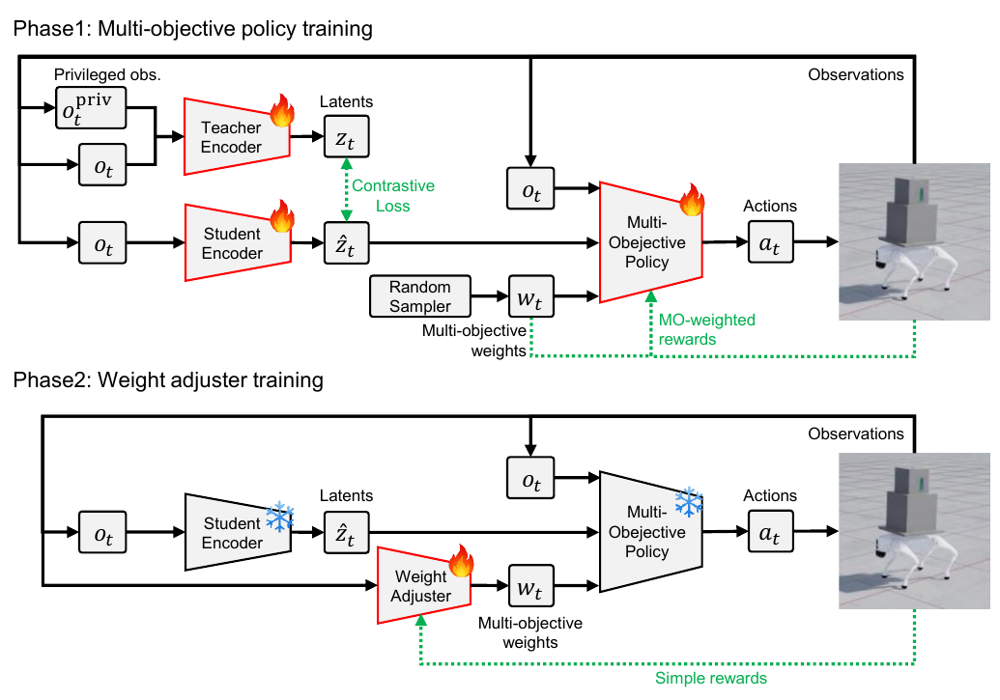
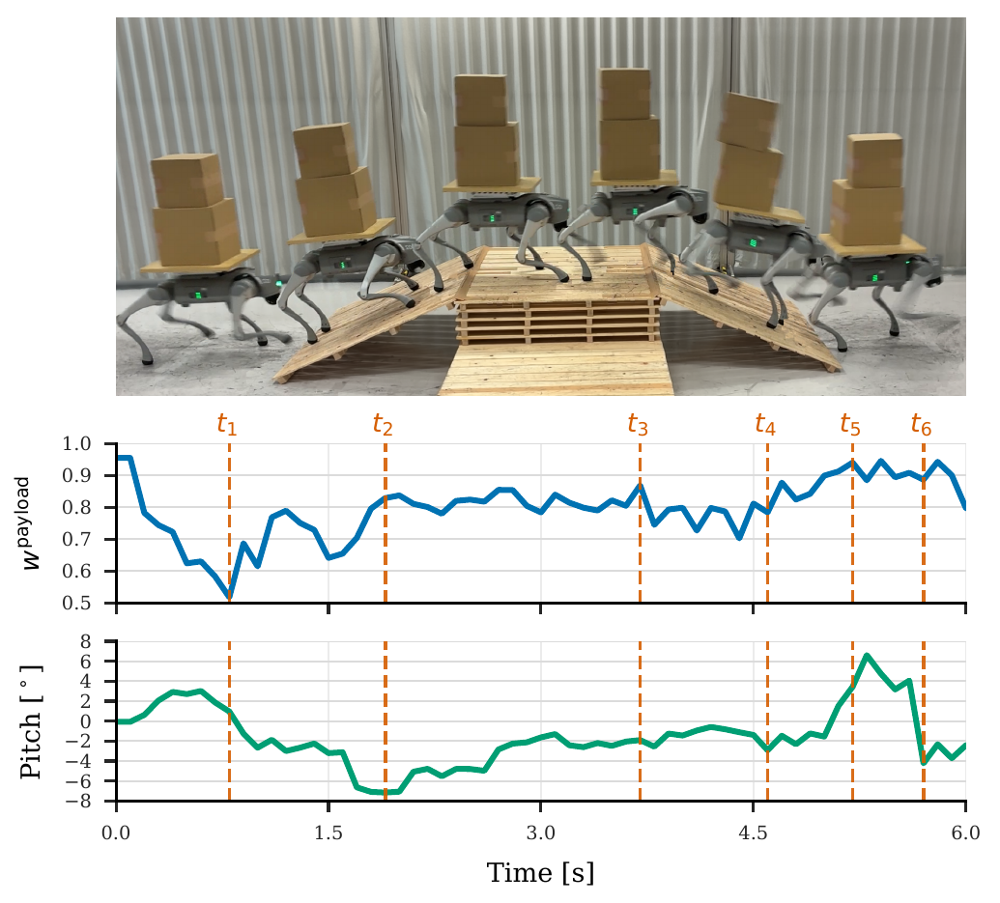
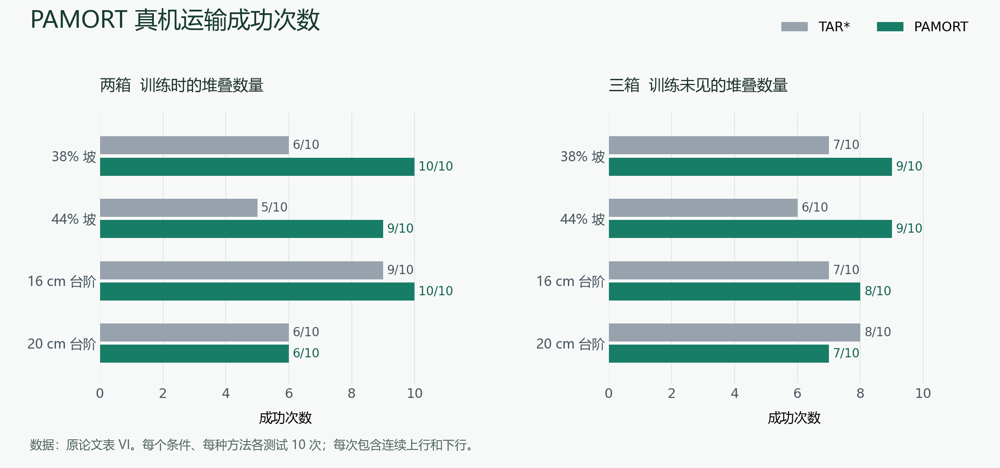

# PAMORT 四足机器人自主调权与堆叠载物运输论文精读

整理日期：2026 年 10 月 20 日

读完 HDPG 后，我继续追问：训练阶段可以调整不同奖励对梯度的影响，那么在机器人真正运行时，能否也根据状态自主调整目标取舍？PAMORT 把这个问题放在四足机器人运输未固定堆叠箱子的场景中。

这次阅读的主线是：**底层先学会在不同偏好下怎样运动，高层再学会面对当前情况该选择什么偏好。** 我尤其关注高层怎样判断权重选得好不好，以及固定外层奖励为什么仍能训练出动态的内部取舍。

前一篇记录：[从 Actor–Critic 到动态奖励权重：HDPG 双足行走论文精读](https://xiaoyong-daydayup.github.io/posts/hdpg-literature-reading/)。

论文事实、教学例子和个人分析在对应段落中区分。两张原论文图用于对照阅读，成功次数图根据论文表 VI 重绘。

## 阅读目录

1. [任务背景与论文信息](#sec-1)
2. [偏好条件策略与两阶段训练](#sec-2)
3. [第一阶段学习不同的目标取舍](#sec-3)
4. [第二阶段学习自主选择权重](#sec-4)
5. [载物感知与稳定控制](#sec-5)
6. [偏好变化与运输实验](#sec-6)
7. [与 HDPG 和固定奖励 PPO 的区别](#sec-7)
8. [固定外层奖励下的分层训练意义](#sec-8)
9. [方法贡献与实验边界](#sec-9)
10. [对后续研究的启发](#sec-10)
11. [参考文献](#references)

## 1 任务背景与论文信息

论文题目是：

**Transporting Unsecured Stacked Payloads with a Quadrupedal Robot via Multi-Objective Reinforcement Learning**

可以译为：

**《通过多目标强化学习，实现四足机器人对未固定堆叠载荷的运输》**

方法名为 **PAMORT**，即 *Payload-Adaptive Multi-Objective Reinforcement learning for Transportation*。

作者是 Nobuo Namura、Masayuki Hiromoto、Kento Uemura、Hironobu Sasaki 和 Kanata Suzuki，均署名日本富士通，前两位等贡献。

**本次阅读版本为 2026 年 10 月 5 日提交的 arXiv:2610.05819v1，8 页。** 截至 2026 年 10 月 20 日，arXiv 条目未列出正式期刊或会议发表信息，这里按预印本讨论。[1](#ref-1)

### 1.1 它的任务有什么特别？

实验平台是 Unitree Go2 四足机器人。机器人背上安装一块平板，上面放置堆叠的箱子：

- 箱子没有绑带或夹具固定；
- 平板没有围边；
- 箱子之间会滑动、倾斜，甚至掉落；
- 部署时没有专门测量箱子状态的传感器。

这和“机器人背着一个固定重物走路”有明显区别。

固定重物主要改变机器人的质量、惯量和重心。未固定的堆叠箱体还增加了**多个物体之间的相对运动和接触问题**：即使机器人自身没有摔倒，货物也可能已经掉下来了。

于是，控制器必须同时处理两个要求：

| 目标 | 希望机器人做到什么 | 可能带来的冲突 |
|---|---|---|
| 运动表现 | 跟踪速度命令，顺利通过地形 | 加速、跨台阶和落地可能使箱子滑动 |
| 载物稳定性 | 减小箱体偏移，避免滑落或倾倒 | 过于保守的运动可能影响前进效率和地形通过能力 |

可以把它想成人端着叠放的餐盘上下楼梯：你仍然要走到目的地，但加速、迈步、躯干姿态和落脚方式都需要随场景调整。

**论文要解决的，就是如何让这种取舍由机器人自己完成。**

## 2 偏好条件策略与两阶段训练

先区分两种容易混淆的“权重”：

- **网络参数 $\theta$**：神经网络内部通过训练学到的参数。
- **偏好权重 $w$**：告诉运动策略当前应该多重视运动、多重视载物的输入。

PAMORT 运行时主要改变的是第二种。

它的部署结构可以概括为：

这里有两个负责决策的模块：

**底层运动策略**接收观测和偏好，决定 12 个关节怎样运动。

**高层权重调节器**，即 Weight Adjuster，简称 WA，接收当前状态信息，决定底层应该采用什么偏好。

训练分成两个阶段：

| 阶段 | 主要学习对象 | 输出 | 偏好来自哪里 |
|---|---|---|---|
| 第一阶段 | 底层运动策略 | 12 个关节位置动作 | 每个回合随机采样 |
| 第二阶段 | 高层权重调节器 | 运动、载物两组权重 | WA 根据当前状态计算 |

第二阶段开始时，已经训练好的底层策略和学生编码器会被冻结。原文图 2 用雪花符号明确标出了这一点。

这个设计的意义是：**先建立一组可调用的运动行为，再学习如何使用它们。**

## 3 第一阶段学习不同的目标取舍

这是理解整篇论文的基础。

### 3.1 先把奖励分成两组

论文没有让 WA 自由修改所有奖励项，而是把它们整理成两组：

$$
\mathbf r_t=
\begin{bmatrix}
r_t^{\mathrm{move}}\\
r_t^{\mathrm{payload}}
\end{bmatrix}.
$$

其中：

**运动奖励组 $r^{\mathrm{move}}$** 包含速度跟踪、关节力矩、动作变化、能耗、足端滑移、接触等常见运动控制项。

**载物奖励组 $r^{\mathrm{payload}}$** 包含上下箱对齐、箱体平面加速度以及首次掉落惩罚。

每组内部仍然有人工设定的系数。例如，线速度跟踪与能耗之间的比例，并不会由 WA 单独调整。

WA 控制的是两组之间的偏好：

$$
\mathbf w=
\begin{bmatrix}
w^{\mathrm{move}}\\
w^{\mathrm{payload}}
\end{bmatrix},
\qquad
w^{\mathrm{move}}+w^{\mathrm{payload}}=1,
\qquad w^g\geq 0.
$$

例如：

- $(0.8,0.2)$：偏重运动表现；
- $(0.2,0.8)$：偏重载物稳定性。

由于两者之和为 1，**这个系统实际上只需要选择一个连续的取舍变量**。

这里的 0.8 表示目标偏好系数，不能解释为“80% 的关节动作负责稳定货物”。

### 3.2 最关键的设计：把偏好输入 Actor

底层策略写成：

$$
a_t\sim
\pi_\theta
\left(
a_t\mid o_t,\hat z_t,\hat v_t,\mathbf w_t
\right).
$$

各项的意义是：

| 符号 | 含义 |
|---|---|
| $o_t$ | 当前本体观测，例如关节状态、躯干角速度、速度命令 |
| $\hat z_t$ | 根据观测历史得到的潜在表示 |
| $\hat v_t$ | 估计的躯干线速度 |
| $\mathbf w_t$ | 当前运动与载物之间的偏好 |
| $a_t$ | 12 个关节位置动作 |

**偏好既影响训练时怎样评价动作，也进入策略输入，影响运行时怎样生成动作。**

这一步非常重要。

假如训练时不断改变奖励权重，却不把权重告诉 Actor，那么同样的观测可能对应不同的评价标准，策略需要在这些标准之间形成某种折中。

现在 Actor 能够区分：

> 当前状态相同，但这次要求我更重视前进；另一次要求我更重视货物稳定。

因此，同一套网络参数可以表示一组不同的条件行为。

### 3.3 这些偏好怎样覆盖？

第一阶段，每个回合开始时采样：

$$
\mathbf w\sim\operatorname{Dirichlet}(1,1).
$$

对这里只有两个权重的情况，可以理解为：

$$
w^{\mathrm{payload}}\sim U[0,1],
\qquad
w^{\mathrm{move}}=1-w^{\mathrm{payload}}.
$$

**同一回合内，权重保持不变。**

这意味着，第一阶段主要让底层学会：

> 在不同固定偏好下，各自应该怎样运动。

随着训练进行，同一个策略会经历偏重速度、偏重载物以及中间各种取舍的任务。

需要注意：它学到的是具有不同偏好的行为集合，并没有理论保证每一个偏好都对应优秀、稳定且互不重复的行为。后面的实验实际上也发现，某些过度偏重运动的权重容易导致掉箱。

### 3.4 它怎样更新 Actor 和 Critic？

这里仍然采用 Actor–Critic 框架，具体训练算法是 PPO。[5](#ref-5)

区别在于，Critic 有两个状态价值头：

$$
V_{\mathrm{move}},\qquad V_{\mathrm{payload}}.
$$

一个估计运动目标的未来回报，另一个估计载物目标的未来回报。

作者先对两组奖励分别进行标准化，再分别计算优势：

$$
A_t^{\mathrm{move}},
\qquad
A_t^{\mathrm{payload}}.
$$

随后，用当前偏好合成一个优势：

$$
\boxed{
\widetilde A_t
=
w^{\mathrm{move}}A_t^{\mathrm{move}}
+
w^{\mathrm{payload}}A_t^{\mathrm{payload}}
}
$$

它的直观意义是：

> 当前动作相对于预期有多好，需要结合当前偏好来判断。

例如，一个动作提高了前进速度，却增加了箱体扰动：

- 当运动权重大时，它可能得到正的综合优势；
- 当载物权重大时，它可能得到负的综合优势。

综合优势随后进入标准 PPO 目标。把原文的“标准 PPO”展开，可以写成：

$$
L_{\mathrm{PPO}}
=
\mathbb E_t
\left[
\min
\left(
\rho_t\widetilde A_t,\,
\operatorname{clip}(\rho_t,1-\epsilon,1+\epsilon)
\widetilde A_t
\right)
\right],
$$

其中 $\rho_t$ 是新旧策略对采样动作的概率比。

这里需要把握两件事：

1. **先分别评价两个目标，再根据偏好合成优势。**
2. **最后仍由一个 Actor 输出整套关节动作。**

两个 Critic 头负责评价，不能理解成一个头控制走路、另一个头控制货物。

另外，本文是“先合并优势，再进行 PPO clipping”。它与“对两个目标分别做 PPO clipping，再加权”一般并不等价。

## 4 第二阶段学习自主选择权重

第一阶段完成后，底层已经具备一个可调接口：

$$
\text{当前观测}+\text{偏好}
\longrightarrow
\text{关节动作}.
$$

第二阶段要解决的是：**谁来选择偏好？**

### 4.1 WA 把权重当成自己的动作

权重调节器接收当前观测、历史潜变量、速度估计和上一时刻权重：

$$
\mathbf u_t
=
f_\phi
\left(
o_t,\hat z_t,\hat v_t,\mathbf w_{t-1}
\right),
$$

再通过 softmax 得到：

$$
\boxed{
\mathbf w_t=\operatorname{softmax}(\mathbf u_t)
}
$$

softmax 保证两个权重非负且和为 1。

从高层智能体的角度看：

- **状态**：机器人现在怎样运动；
- **动作**：选择什么运动—载物偏好；
- **环境反馈**：底层按这个偏好运动后，运输效果怎样。

因此，它是一个“以偏好为动作”的强化学习问题。

### 4.2 权重怎样学得合理？

训练时的因果关系是：

1. WA 根据当前状态尝试一个偏好。
2. 冻结的底层策略按这个偏好产生关节动作。
3. 机器人与箱体在仿真中运动。
4. 环境产生运输任务奖励。
5. WA 的 PPO 根据后续回报，更新 WA 网络参数。

如果某类状态下选择较高的载物权重能带来更好的后续结果，那么训练就会提高 WA 在类似状态下作出这种选择的倾向。

这里对“合理”的定义来自**后续运输效果**，并不需要研究者直接标注“上坡时权重应该是 0.8”。

底层参数在这个阶段保持固定，所以高层学习过程中，底层的行为接口相对稳定。

### 4.3 最重要的问题：WA 用什么奖励训练？

我在阅读中追问的关键问题是：

> 如果系统能改变奖励权重，它会不会通过降低困难目标的权重，让自己看起来表现更好？

PAMORT 为 WA 设置了**独立、固定的标量任务奖励**。

按原文表 I 整理，其主要环境奖励是：

$$
\begin{aligned}
r_t^{\mathrm{WA}}
={}&
1.5r_t^{v}
+0.75r_t^{\omega}\\
&+2r_{t,\mathrm{align}}^{\mathrm{bottom}}
+2r_{t,\mathrm{align}}^{\mathrm{top}}\\
&-2.5p_{t,\mathrm{acc}}^{\mathrm{bottom}}
-0.25p_{t,\mathrm{acc}}^{\mathrm{top}}.
\end{aligned}
$$

| WA 的评价内容 | 固定系数 |
|---|---:|
| 线速度跟踪 | +1.5 |
| 角速度跟踪 | +0.75 |
| 下层箱体对齐 | +2.0 |
| 上层箱体对齐 | +2.0 |
| 下层箱体平面加速度代价 | −2.5 |
| 上层箱体平面加速度代价 | −0.25 |

这些系数来自原论文表 I。平滑损失另列于式（5），掉箱则通过终止回合影响后续回报。[1](#ref-1)

它考核：

- 线速度和角速度跟踪；
- 上下箱体的对齐程度；
- 上下箱体的平面加速度；
- 箱子掉落时，终止回合。

**WA 输出的 $\mathbf w_t$，不会被拿来重新给 WA 自己打分。**

所以，即使 WA 选择很低的载物偏好，只要这样导致箱子失稳，它仍然会受到固定外层目标的评价。

这构成了一个清楚的分工：

> **人定义最终运输标准；底层提供不同取舍下的运动能力；高层学习怎样调用这些能力。**

#### 4.3.1 从状态到权重的学习过程

下面用一个教学例子串起状态、偏好、执行结果和学习反馈，**表中不是论文实验数据**。

| 当前情形 | 尝试的偏好 | 可能产生的后果 | 训练反馈 |
|---|---|---|---|
| 平地，箱体稳定，但跟不上速度命令 | 适当增加运动权重 | 速度跟踪改善，箱体仍稳定 | 这种选择可能得到较好的评价 |
| 同样的平地状态 | 始终把载物权重设得很高 | 箱体稳定，但前进过于保守 | 总体回报可能较低 |
| 越过台阶后，躯干扰动较大 | 适当增加载物权重 | 减少箱体偏移，完成后续运输 | 这种选择可能得到较好的评价 |
| 同样的扰动状态 | 继续强烈追求速度 | 当下速度很好，但随后掉箱 | 后续回报会使这次选择受到不利评价 |

这里的关键是**后续回报**。

如果一个权重在当前瞬间让速度更准确，却导致几步之后掉箱，那么只看即时奖励可能会认为它很好。强化学习通过累计回报和价值估计，让后面的结果也影响此前的选择。

#### 4.3.2 Critic 如何评价权重选择

高层 Critic 估计的是：

> 在当前情形下，按照目前的调权策略继续执行，预计还能获得多少回报？

PPO 根据实际采样结果和价值预测构造优势信号：

- 结果比预期好，增加类似状态下采用这类选择的倾向；
- 结果比预期差，降低这种倾向。

**Critic 不直接给出“最佳权重标准答案”。** 它提供评价基准，Actor 通过反复试验逐渐学会选择。这也意味着，学到的调权规律有近似误差，不能保证每次都最优。

### 4.4 运行时调权，不需要现场重新训练

本文的底层控制频率是 **50 Hz**，即每 20 ms 输出一次关节动作。

WA 每 4 个底层控制步更新一次权重：

$$
4\times20\ \mathrm{ms}=80\ \mathrm{ms},
$$

对应 **12.5 Hz**。

两次调权之间，偏好保持不变，但底层仍然根据新的观测更新动作。

这里的“在线自适应”指的是：**已经训练好的 WA 实时计算新的偏好。** 论文没有提出真机运行时继续做梯度更新的流程。

训练和运行的区别是：

| 环节 | 仿真训练 WA 时 | 真机运行时 |
|---|---|---|
| 获取本体观测和历史信息 | 需要 | 需要 |
| WA 输出偏好 | 需要 | 需要 |
| 利用箱体真值计算训练奖励 | 需要 | 不需要 |
| 使用 Critic、PPO 更新 WA 参数 | 需要 | 不需要 |
| 底层按偏好执行运动 | 需要 | 需要 |

仿真能够直接读取箱子的位置、加速度等信息，用来计算奖励。但训练好的 WA 在真机上只需根据可获得的观测进行一次前向计算，就能输出权重。

为避免权重抖动，作者还加入了：

$$
L_{\mathrm{smooth}}
=
\lambda_t
\left\|
\mathbf w_t-\mathbf w_{t-1}
\right\|_2^2.
$$

式（5）给出的系数范围是 $\lambda_t\in[0.02,0.5]$。状态稳定时加强平滑约束，命令或姿态快速变化时减弱约束，使权重能够及时响应。[1](#ref-1)

## 5 载物感知与稳定控制

自主调权依赖有效的状态表示和底层控制能力，因此还需要看清载物信息如何进入学习过程。

### 5.1 部署时没有箱体传感器，训练时有箱体真值

论文沿用了 TAR 的教师—学生表征框架。[4](#ref-4)

训练时，教师编码器和 Critic 可以使用 **195 维特权信息**，其中包含：

- 机器人真实状态；
- 随机化的动力学参数；
- 足端接触力和地形高度；
- 两个箱体的完整状态与物理参数。

学生编码器则主要依靠 **45 维本体观测**，通过 LSTM 保留历史信息，输出一个 **64 维潜变量**。

训练会让学生从本体观测历史中学到与教师表征相联系的信息。部署时，使用学生编码器、速度估计器、底层 Actor 和 WA 即可，教师和训练用 Critic 不进入实时动作生成链。

从物理上可以这样理解：载物运动会影响机器人躯干和关节的响应，历史观测可能包含与载物情况相关的线索。

不过，论文并没有证明这个潜变量能精确恢复箱子的位置、摩擦系数或滑移状态。更稳妥的理解是：

> **它学习的是有助于控制的间接状态表示。**

“部署不直接测量箱体状态”和“训练完全不使用箱体状态”是两件不同的事。

### 5.2 载物稳定性不等于始终保持躯干水平

载物奖励中有两个很有物理意义的设计。

**第一，鼓励箱体对齐。**

下层箱子应靠近平板中心，上层箱子应靠近下层箱子的中心。这样可以减少堆叠偏移。

**第二，约束支撑平面内的有效加速度。**

原文用类似下面的量描述：

$$
\mathbf u^i
=
\frac{
\mathbf g_{xy}^i-\mathbf a_{xy}^i
}{
\|\mathbf g\|_2
}.
$$

其中，重力和箱体加速度被投影到对应支撑坐标系的平面内。

直观上，箱体是否容易滑动，既受到平板倾斜的影响，也受到加速、减速等运动的影响。因此，适当改变躯干姿态，有时有助于抵消运动造成的扰动。

作者进一步设置一个与箱体偏移有关的恢复方向 $\mathbf u_\star^i$，并使用：

$$
p_{\mathrm{acc}}^i
=
\left[
\frac{
\|\mathbf u^i\|_2+
\|\mathbf u^i-\mathbf u_\star^i\|_2
}{2}
\right]^2.
$$

这项设计兼顾减少多余平面加速度和允许向中心恢复的运动，再与对齐奖励共同作用。

因此，策略可能学到适当的躯干倾斜、启动和制动方式。**奖励在引导载物的物理稳定性，而不仅仅是在要求机器人姿态好看。**

### 5.3 训练课程也需要适应偏好

作者还提出了“偏好感知的地形课程”。

如果一个策略当前很重视载物，它可能主动采用较保守的运动。若课程只根据走了多远决定是否提高难度，就容易把这种行为与能力不足混在一起。

因此，作者结合运动进展与载物保持情况，并按照当前偏好综合评价，再决定地形难度的升降。

另一个有意思的设计是：

- **底层多目标训练时**，掉箱不会立刻终止回合，而是给予首次掉落惩罚，并屏蔽相应箱体后续的部分奖励；
- **WA 训练时**，掉箱会终止回合。

前者允许偏重运动的底层继续积累运动经验；后者使高层明确承担完整运输任务的要求。

这些设计也说明，PAMORT 的效果来自一套训练系统，不能只用“多加了一个调权网络”概括。

## 6 偏好变化与运输实验

实验可以分成三个问题来读：

1. 权重是否真的能改变行为？
2. 机器人运行时是否真的在调权？
3. 最终任务成功率是否提高？

### 6.1 一个策略确实覆盖了不同取舍

作者用 21 个不同偏好测试同一个底层策略，并与多个分别训练的固定权重策略比较。

图 3 显示，部分偏好能够形成不同的运动—载物回报取舍，其中载物权重约为 $0.4$ 到 $1.0$ 的点表现为所比较样本中的非支配解。

所谓非支配，可以简单理解为：

> 在这些被比较的结果中，找不到另一个结果，在运动和载物两个方面都更好。

这支持“一个条件策略能提供多个有用取舍”的主张。

但它是经验结果，不能据此认为作者已经求出了整个问题的真实最优 Pareto 前沿。

### 6.2 真机上确实出现了随状态变化的权重

原文图 6 展示了一次两箱运输、上下坡的代表性轨迹。

载物偏好大致表现为：

| 运动阶段 | 观察到的载物权重 |
|---|---:|
| 初始静止 | 约 0.95 |
| 平地启动 | 可降至约 0.5–0.7 |
| 上坡 | 约 0.8 |
| 下坡和落地 | 约 0.9 |

这给出了直观证据：同一次运动中，系统会采用不同的偏好。

这些数值是某次试验的学习结果，不能当成作者手写的规则，也不能推广成“所有上坡都应使用 0.8”。

还有一个读图细节：论文写的是 **44% 坡度**，换算约为 **24°**，并非 44°。

### 6.3 仿真成功率：平均提高，但不是所有地形都提高

主仿真实验以 1 m/s 的前进速度命令，要求机器人在 15 s 内完成 10 m 运输，不能摔倒，也不能掉箱。每个单向地形在 10 个难度等级上各测试 100 次，物理参数按训练范围随机化。

训练使用两箱配置，测试扩展到 0、1、2、3 箱。原文表 IV 的总体平均结果为：

| 载物数量 | TAR* 基线 | PAMORT | 绝对提高 |
|---|---:|---:|---:|
| 0 箱 | 78.2% | 80.1% | 1.9 个百分点 |
| 1 箱 | 72.3% | 75.8% | 3.5 个百分点 |
| 2 箱，训练配置 | 65.0% | 68.7% | 3.7 个百分点 |
| 3 箱，未见堆叠数量 | 53.0% | 55.0% | 2.0 个百分点 |

TAR* 是作者为运输任务适配的 TAR 基线。

这里可以得出两个判断：

**其一，平均收益存在，但仿真提升幅度主要是几个百分点。**

**其二，它没有在所有条件下占优。** 例如，随机粗糙地形的四种载物配置中，PAMORT 都低于 TAR*；部分下坡任务也有退步。

因此，应把结论限定为“总体平均改善，并在部分条件下更有优势”。

### 6.4 实机成功率：总体差异更大，但样本较少

真机使用两箱和三箱配置，在四种地形条件下测试。每种方法、每个条件做 10 次试验，每次包含连续上行和下行。

原文表 VI 为：

| 地形 | 两箱 TAR* | 两箱 PAMORT | 三箱 TAR* | 三箱 PAMORT |
|---|---:|---:|---:|---:|
| 38% 坡 | 60% | 100% | 70% | 90% |
| 44% 坡 | 50% | 90% | 60% | 90% |
| 16 cm 台阶 | 90% | 100% | 70% | 80% |
| 20 cm 台阶 | 60% | 60% | 80% | 70% |
| 平均 | 65.0% | 87.5% | 70.0% | 82.5% |

合并这 8 项任务：

- TAR*：54/80 次成功，**67.5%**；
- PAMORT：68/80 次成功，**85.0%**；
- 绝对提升：**17.5 个百分点**。

这说明整套方法在本文实机测试中有实际价值。

同时，每个条件只有 10 次试验，100% 代表这 10 次全部成功，不能理解成长期成功概率已经达到 100%。三箱、20 cm 台阶这一项，PAMORT 也低于基线。

以上数据分别对应原文图 3、图 6、表 IV 和表 VI。[1](#ref-1)

## 7 与 HDPG 和固定奖励 PPO 的区别

这一部分可以接回上一篇 HDPG 的学习记录。

### 7.1 与常见固定奖励 PPO 的区别

常见固定奖励 PPO 会先把所有奖励项加成一个标量，然后学习一个价值函数，并训练 Actor。

PAMORT 的第一阶段增加了两件事：

1. 保留运动、载物两组价值评价，再按偏好合并优势；
2. 把偏好本身输入 Actor，使它能够响应不同目标取舍。

第二阶段又增加一个 Actor–Critic 系统，让高层 Actor 学习输出偏好。

因此，**PAMORT 仍然建立在 Actor–Critic 上，它改变的是目标表示、策略条件以及决策层次。**

### 7.2 与 HDPG 的区别

| 比较维度 | 前面讨论的 HDPG | PAMORT |
|---|---|---|
| 主要算法 | 基于 DDPG 的策略梯度方法 | 基于 PPO 的两阶段方法 |
| 多头 Critic | 不同奖励分量的 $Q$ 头 | 运动、载物两组 $V$ 头 |
| 权重如何得到 | 根据奖励统计量设计的更新规则 | 第一阶段随机采样，第二阶段学习 WA |
| 权重是否作为 Actor 输入 | 原文架构没有这一条件输入 | 明确输入底层 Actor |
| 权重主要作用于哪里 | 训练时不同目标的策略梯度贡献 | 训练时的优势组合，以及部署时的行为选择 |
| 是否有高层调权策略 | 没有这一模块 | 有，WA 以权重为动作 |
| 真机运行中的调权 | 原文未提供类似的在线偏好选择机制 | 每 80 ms 计算新的偏好 |

HDPG 更直接地研究：

> 在学习过程中，怎样协调不同奖励分量对策略更新的影响？

PAMORT 则把问题推进到：

> 已经学到不同取舍的运动能力后，怎样在运行过程中选择合适的取舍？

HDPG 的比较依据是此前那篇原文。[2](#ref-2)

## 8 固定外层奖励下的分层训练意义

这是理解这篇论文最深的一层。

这里仍有一个需要解释的问题：

> 既然 WA 最后还是优化固定的运输奖励，为什么不直接用这套奖励训练一个普通运动策略？

**直接训练在原理上完全有可能。固定奖励也可以训练出随地形和状态变化的行为。**

一个固定奖励函数 $r(s,a)$，并不要求策略在所有状态下采取同一种动作。足够好的状态相关策略，本来就可以在平地、坡地和台阶上采用不同运动方式。

PAMORT 的价值主要在于它对学习问题作了结构化分解。

**奖励设计仍然存在。** 人定义什么样的运输结果算好，WA 学习当前状态下怎样调用底层能力。固定的外层任务标准与变化的内部偏好并不矛盾。如果外层奖励过度强调速度或载物，WA 也可能学得过于激进或保守；自主调权不能自动修正一个不合适的评价标准。

### 8.1 先积累行为，再学习调用

直接训练时，策略需要同时学会：

- 关节怎样协调；
- 如何维持机器人稳定；
- 如何稳定箱子；
- 什么状态下应更积极或更保守。

PAMORT 先让底层积累不同取舍下的运动能力，再让高层学习调用关系。

从结构上看，这可能让高层更容易学习。不过，本文没有通过严格等预算实验，证明这种分解一定更节省总训练样本。

### 8.2 高层探索的是一个较低维的动作空间

底层 Actor 输出 12 个关节位置动作。

高层 WA 输出两个和为 1 的权重，实际上只有一个自由度。它主要探索：

> 此刻应该更偏向运动，还是更偏向载物？

这种动作空间已经带有明确的行为含义，而且受到预训练底层的约束。

但它也有边界：**底层没有学会的能力，高层通常无法仅靠调权创造出来。**

如果所有偏好下都过不了某个台阶，那么不断改变权重也未必能解决问题。

### 8.3 训练后的取舍可以直接调整

普通固定权重训练通常把偏好固化进网络参数。想系统改变取舍，往往需要重新训练或微调。

PAMORT 把取舍保留为输入变量，因此训练完成后仍可调整。

这既便于自动选择，也便于观察与调试：研究者可以记录权重轨迹，查看系统在什么状态下提高了载物偏好。

因此，这条路线的主要吸引力是：

**把目标取舍变成一个可学习、可观察、可在运行中使用的控制接口。**

## 9 方法贡献与实验边界

### 9.1 有价值的贡献

我认为，这项工作的价值集中在三个方面。

**第一，把未固定的堆叠载物运输作为一个完整控制问题来解决。**

机器人自身稳定与载物稳定同时存在，而且载物状态在部署时不能直接获得，这比常规速度跟踪更复杂。

**第二，将偏好条件策略、历史状态表示、在线权重选择和地形课程组合成可运行的系统。**

这些模块针对同一个运输问题相互配合，并且给出了真实机器人的实验。

**第三，提供了运行时偏好变化与任务成功率的证据。**

图 6 让“自适应调权”具有可观察的行为过程，实机对照说明整套系统有实际收益。

### 9.2 自主调权的总体思路有明确前作

PAMORT 不是首次提出“训练一个以权重为输入的策略，再冻结它、训练高层选择权重”。

前作 **AMOR** 已经明确使用这条路线：冻结底层控制器，再学习高层策略动态选择偏好。PAMORT 自己在相关工作部分也承认沿着这一方向开展。[3](#ref-3)

因此，更准确的创新定位是：

> **在已有多目标和分层调权框架上，针对未固定堆叠载物运输的部分可观测性、目标冲突和真实接触问题，提出具体方法设计并完成实机验证。**

这个定位仍然有研究价值，同时避免把已有思想归为本文首创。

### 9.3 性能提升不能全部归因于 WA

基线与 PAMORT 的训练预算并不一致：

| 训练部分 | 并行环境数 | GPU 数 | 训练迭代 |
|---|---:|---:|---:|
| TAR* | 8,192 | 4 | 130,000 |
| PAMORT 底层 | 16,384 | 8 | 130,000 |
| PAMORT 的 WA | 8,192 | 4 | 额外 5,000 |

同样的迭代次数，在每次使用两倍并行环境时，不代表相同样本量。

此外，课程、掉箱终止方式和模型选择方法也有变化。因此，现有实验说明的是**整套方法的效果**，还没有完全分离出 WA、课程和其他设计各自的贡献。

### 9.4 动态调权尚未证明优于充分调好的最佳固定权重

这一点影响对动态调权收益的判断。

作者还评估了一个“按条件选择最佳固定偏好”的参照：为每一种地形与载物条件离线搜索一个合适的固定权重。

其平均成功率为：

- 按条件选择的最佳固定偏好参照：**73.8%**；
- PAMORT 在线选择：**69.9%**。

PAMORT 达到该经验参照的约 **94.7%**。

这个结果支持：

> 自动选择器可以在不需要按条件离线调参的情况下，取得接近该参照的表现。

它没有证明动态权重必然比所有固定权重更好。作者还指出，最佳全局固定偏好也能取得具有竞争力的总体表现，但没有完整列出相应的具体结果。

### 9.5 泛化能力应按实际测试范围理解

论文测试了更多箱体层数和更高地形难度，这是有意义的。

但仿真中的地形家族与训练相同；所谓未见条件，主要是新的载物数量以及超出训练上限的难度。

另外，高难度评估已经用于选择训练检查点。严格说，这些难度超出了梯度训练范围，但不能称为完全没有参与任何模型选择的独立测试条件。

论文也没有验证任意形状、液体、柔性物体或任意新地形下的稳定运输。

## 10 对后续研究的启发

我关心的是：能否让一个机器人面对不同地形、不同运动需求，自主改变目标取舍，而不依赖人不断切换策略？

PAMORT 给出了一条具体可行的路线：

1. **选择少量具有明确含义的目标组**，例如运动表现、稳定性、能耗或载物保持。
2. **训练一个接受目标偏好的条件策略**，让不同偏好对应不同的有效行为。
3. **用固定的最终任务标准训练高层选择器**，让它根据状态决定调用哪种取舍。
4. **部署时实时计算偏好**，同时保持已有运动能力。

外部仍然可以给机器人速度或任务命令；本文自主化的是执行任务时的目标取舍。它并未把自主导航、任务生成等问题一并解决。

对后续研究而言，最值得验证的核心问题是：

> **在同一套底层条件策略、相同计算预算和统一测试条件下，学习得到的动态调权，能否稳定超过最佳全局固定权重，以及简单的状态调权规则？**

这个对照一旦成立，就能更有力地说明：系统的收益确实来自**根据当前情形选择目标取舍**。

读这篇论文时，可以把图 2 当作主线：先弄清第一阶段如何形成“可调的运动能力”，再弄清第二阶段如何用固定任务目标学习选择偏好，最后用图 6 和实验表格判断这种选择究竟带来了多大收益。

## 参考文献

**[1]** Namura, N., Hiromoto, M., Uemura, K., Sasaki, H., & Suzuki, K. (2026). *Transporting Unsecured Stacked Payloads with a Quadrupedal Robot via Multi-Objective Reinforcement Learning*. arXiv:2610.05819v1，2026-10-05。[论文条目](https://arxiv.org/abs/2610.05819v1) · [PDF 原文](https://arxiv.org/pdf/2610.05819v1) · [HTML 原文](https://arxiv.org/html/2610.05819v1)。方法见 §III，网络与训练设置见 §IV，实验见 §V；本笔记重点对照表 I、IV、VI 和图 2、6。

**[2]** Huang, C., Wang, G., Zhou, Z., Zhang, R., & Lin, L. (2023). *Reward-Adaptive Reinforcement Learning: Dynamic Policy Gradient Optimization for Bipedal Locomotion*. IEEE TPAMI, 45(6), 7686–7695。[DOI](https://doi.org/10.1109/TPAMI.2022.3223407) · [此前的 HDPG 精读](https://xiaoyong-daydayup.github.io/posts/hdpg-literature-reading/)。

**[3]** Alegre, L. N., Serifi, A., Grandia, R., Müller, D., Knoop, E., & Bächer, M. (2025). *AMOR: Adaptive Character Control through Multi-Objective Reinforcement Learning*. SIGGRAPH Conference Papers 2025。[DOI](https://doi.org/10.1145/3721238.3730656) · [arXiv](https://arxiv.org/abs/2505.23708)。是 PAMORT 相关工作中明确列出的动态偏好选择先例。

**[4]** Mousa, A., Karavis, N., Caprio, M., Pan, W., & Allmendinger, R. (2025). *TAR: Teacher-Aligned Representations via Contrastive Learning for Quadrupedal Locomotion*. IROS 2025, 11669–11676。[arXiv](https://arxiv.org/abs/2503.20839) · [作者项目页](https://ammousa.github.io/TARLoco/)。PAMORT 的教师—学生表征骨干。

**[5]** Schulman, J., Wolski, F., Dhariwal, P., Radford, A., & Klimov, O. (2017). *Proximal Policy Optimization Algorithms*。[arXiv:1707.06347](https://arxiv.org/abs/1707.06347)。正文展开的 clipped PPO 目标用于说明标准算法与分组优势的关系。
